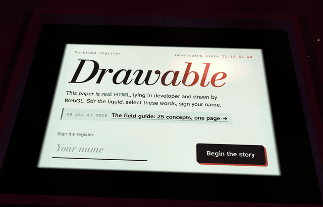
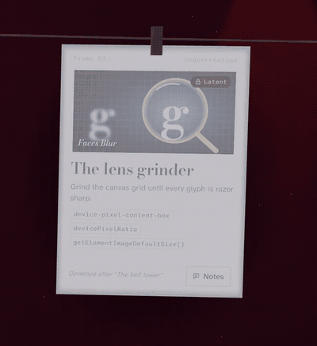
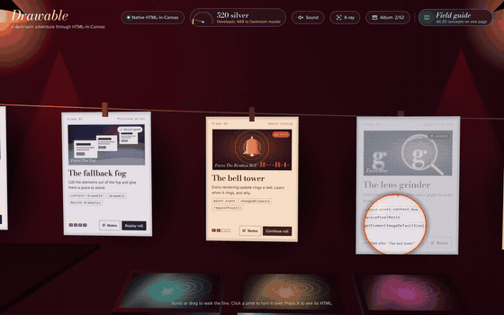
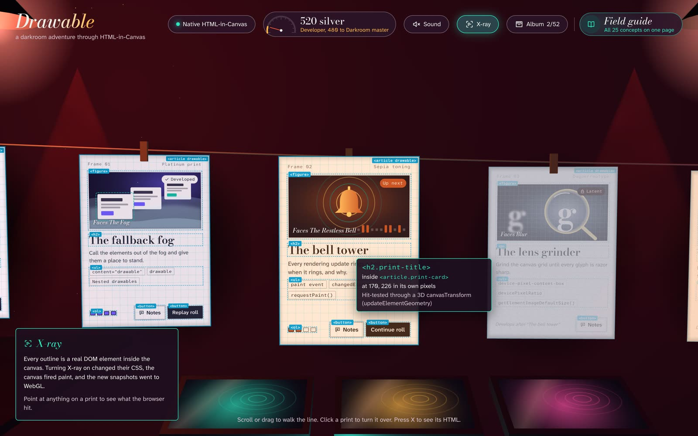
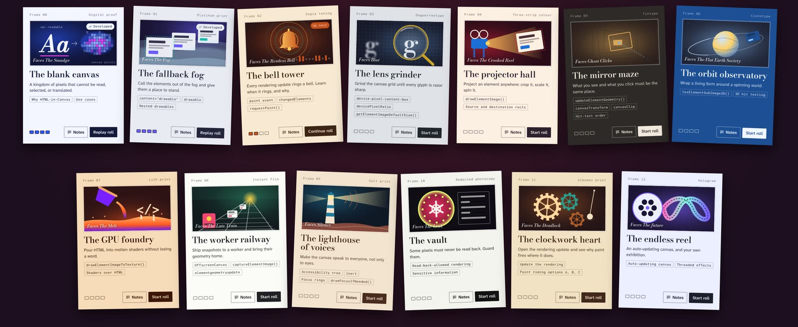
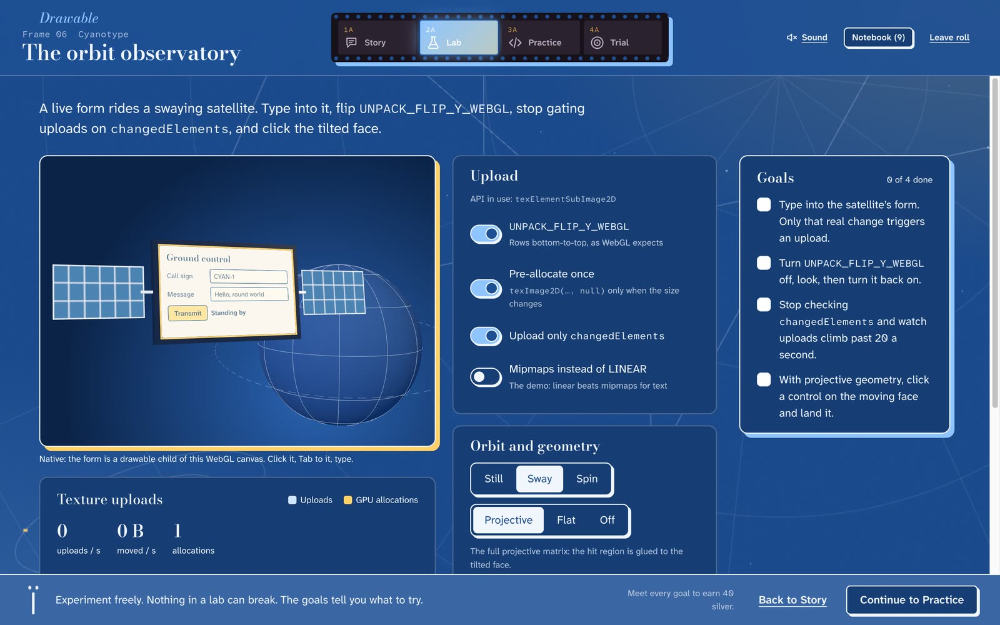
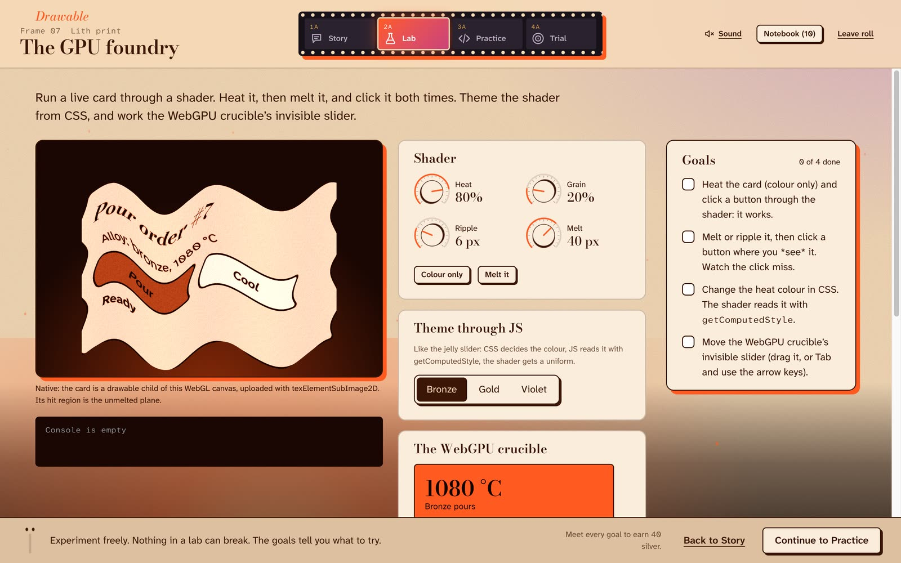
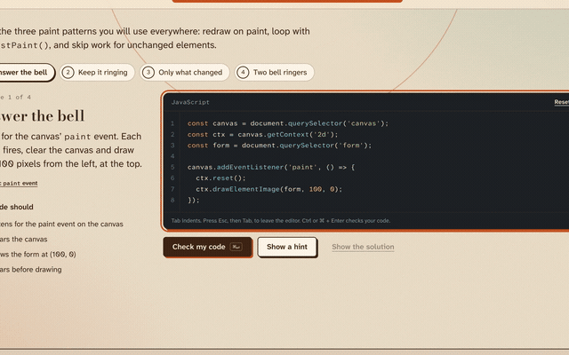

<div align="center">

<a href="https://htmlincanvas.vercel.app"></a>

# Drawable

**Learn HTML-in-Canvas by developing it in a darkroom.**

A 3D, story-driven course where every page is real HTML drawn into a canvas,<br>
and you can still click it, select it, Tab to it, and type into it.

[**Play it live**](https://htmlincanvas.vercel.app) · [**The field guide**](https://htmlincanvas.vercel.app/guide) · [How it works](#under-the-hood) · [Run it locally](#run-it-locally)


</div>

---

## Canvas has always eaten your text

Put words into a `<canvas>` and they stop being words. Screen readers can't read them, you can't select them, translation tools skip them, and buttons have to be faked with hit-boxes and prayers.

The [WICG HTML-in-Canvas proposal](https://github.com/WICG/html-in-canvas) fixes that. A canvas can now **draw real HTML elements** while the browser keeps them alive: laid out, accessible, focusable and clickable, even on a tilted 3D surface.

```html
<canvas id="darkroom" content="drawable">
  <form drawable>
    <label>Your name <input></label>
    <button>Develop</button>
  </form>
</canvas>

<script>
  const ctx = darkroom.getContext('2d');
  const form = darkroom.querySelector('form');
  darkroom.onpaint = () => {
    ctx.reset();
    ctx.drawElementImage(form, 40, 40); // a live form, drawn into pixels
  };
</script>
```

**Drawable** teaches the whole API by using it everywhere. You walk through a darkroom, each chapter hangs on the wire as a photographic print, and every print is real HTML rendered by WebGL. Start with "why can't canvas text be read?" and end up fluent in `paint` events, 3D hit testing, workers, WebGPU, accessibility and the rendering update.

> 🎞️ **Open it in Chrome 157 or later** to see the real API at work. Every other browser gets a faithful simulation with the same rules and goals, and the top bar tells you which mode you're in.

## The 30-second tour

<table>
<tr>
<td width="50%" valign="top">

**Peek at what's coming.** Locked chapters hang as latent images. Hover one and a safelight loupe develops the spot under your pointer.



</td>
<td width="50%" valign="top">

**Turn any print over.** The back is HTML too: what you'll learn, the four frames, what you'll build. Use ← and → to browse, and Esc to hang it back.



</td>
</tr>
</table>

**Press X to see the DOM.** X-ray outlines every element inside the 3D prints. The tooltip names the element your pointer is on, in that element's own pixels, after the browser hit-tested it through the 3D transform. No raycasting involved.



## Thirteen rolls of film

Each chapter is a roll printed with a different historical photographic process (platinum, cyanotype, tintype, lith…), which gives it its own palette, picture, textures and sounds.



| # | Chapter | You face | You learn |
| --- | --- | --- | --- |
| 00 | The blank canvas | The Smudge | Why HTML-in-Canvas, use cases |
| 01 | The fallback fog | The Fog | `content="drawable"`, `drawable`, nested drawables |
| 02 | The bell tower | The Restless Bell | the `paint` event, `changedElements`, `requestPaint()` |
| 03 | The lens grinder | Blur | `device-pixel-content-box`, `devicePixelRatio`, `getElementImageDefaultSize()` |
| 04 | The projector hall | The Crooked Reel | `drawElementImage()`, source and destination rects |
| 05 | The mirror maze | Ghost Clicks | `updateElementGeometry()`, `canvasTransform`, `canvasClip`, hit-test order |
| 06 | The orbit observatory | The Flat Earth Society | `texElementSubImage2D()`, 3D hit testing |
| 07 | The GPU foundry | The Melt | `drawElementImageToTexture()`, shaders over HTML |
| 08 | The worker railway | The Late Train | `OffscreenCanvas`, `captureElementImage()`, `elementgeometryupdate` |
| 09 | The lighthouse of voices | Silence | the accessibility tree, `inert`, focus rings, `drawFocusIfNeeded()` |
| 10 | The vault | The Leak | read-back-allowed rendering, sensitive information |
| 11 | The clockwork heart | The Deadlock | update the rendering, paint timing options A, B and C |
| 12 | The endless reel | The future | the auto-updating canvas, threaded effects |

Finishing a chapter's trial develops the next print.

## How a chapter plays

Every chapter has four frames, shown as a filmstrip at the top of the screen.

1. **📖 Story.** A short scene beside a 3D diorama that reacts to each line. Every concept lands on a card in your **notebook**, which you can reopen at any time.
2. **🧪 Lab.** A playground built on the real API, with goals to tick off. In Chrome 157, the exceptions, `paint` events and hit tests you see are the browser's own, not a mock.
3. **⌨️ Practice.** Short exercises you write by hand. Requirements are listed up front and checked as you type, and help comes in steps: a hint, another hint, then the solution. Your code is saved per exercise, and *Reset* can be undone.
4. **🎯 Trial.** Prove it: predict when the bell rings, fix a broken timetable, aim through a projection.

<table>
<tr>
<td width="50%"></td>
<td width="50%"></td>
</tr>
<tr>
<td align="center"><sub>A form you can type into, riding a satellite. Clicks land on the moving face.</sub></td>
<td align="center"><sub>HTML poured through a melt shader, and the buttons still work.</sub></td>
</tr>
</table>

### Your code, running

Solve an exercise and the page cheers with **confetti made of HTML** (code chips, stars and paper squares, all drawn into one canvas). Then a live scene opens under it and **acts out what your code does**. Answer the bell, and a bell rings on every `paint` while the readout lists `changedElements`.



All 38 exercises have one. Some of them:
- captured snapshots ride a railway as frozen carriages, each showing a different time;
- a tilting button you can actually catch;
- a pie chart whose focused wedge gets a real `drawFocusIfNeeded` ring;
- a vault that reads back real pixels and exports a real PNG.

## Small things we're proud of

- **🔊 The labs sound like their places.** Sound is off until you turn it on. Then the fog has a foghorn, the bell tower a struck bell (only on *real* changes), the projector a clattering film gate, the railway a whistle for late trains, and the clockwork a tick-tock. Plain clicks stay silent, and a sound that keeps firing backs off instead of droning. All of it is synthesized, with no audio files.
- **🏆 Progress worth collecting.** Silver, ranks from Apprentice to Darkroom master, stamps for clean runs, and 52 negatives hidden in the labs and trials for your album.
- **🌊 A first impression with a ripple.** The opening card is real HTML lying in developer: type your name and the liquid ripples out from the field you're typing in.
- **♿ Accessible by construction.** Prints are real DOM, so they're in the accessibility tree; turned-away faces become `inert`; everything works by keyboard; and `prefers-reduced-motion` turns off camera glides, swaying and confetti.
- **⚡ Fast for what it is.** The frame rate is capped at 60 fps (30 when idle), the world stops drawing when a chapter covers it, only prints on screen upload, and sound, confetti and proof scenes load when first needed. [The numbers are here.](perf/README.md)

## Run it locally

You need **Node.js 20.19+ or 22.12+** (Vite 8's requirement) and **pnpm**.

```sh
pnpm install
pnpm dev
```

Open the address Vite prints (usually <http://localhost:5173>). The darkroom is at `/` and the field guide at `/guide.html`.

| Command | What it does |
| --- | --- |
| `pnpm dev` | Start the dev server with hot reload |
| `pnpm build` | Typecheck, build both pages, and enforce the bundle budget |
| `pnpm preview` | Serve the production build locally |
| `pnpm test` | Run the unit tests once (`pnpm test:watch` to keep watching) |
| `pnpm typecheck` | Typecheck without building |
| `pnpm perf:budget` | Check the bundle budget of the last build |

### Shortcuts for exploring

URL switches combine: `?reset&unlock=all` gives a fresh save with every chapter open.

| Switch | Effect |
| --- | --- |
| `?unlock=all` | Open every chapter |
| `?reset` | Wipe saved progress and saved exercise code |
| `?sim` | Force the simulated fallback, even when the API exists |
| `#/roll/<id>` | Jump to a chapter, e.g. `#/roll/bells` |
| `#/roll/<id>/<frame>` | Jump to a frame: `story`, `lab`, `practice` or `trial` |

Chapter ids are `prologue`, `fog`, `bells`, `lens`, `projector`, `mirrors`, `observatory`, `foundry`, `railway`, `lighthouse`, `vault`, `clockwork` and `epilogue`.

In the darkroom:
- **Scroll, drag or use ← →** to walk the line, and **Tab** to visit the prints.
- **Click** a print to turn it over, and **Esc** to hang it back.
- **X** toggles X-ray.

## Browser support

| Browser | What you get |
| --- | --- |
| **Chrome 157+** | **Native.** Prints, labs and figures use the real API: `drawable` children of WebGL and 2D canvases, real `paint` events, real exceptions, browser hit testing through 3D transforms, and WebGPU where available. |
| **Everything else** | **Simulated.** Prints are placed with CSS 3D transforms, and labs run a simulation with the same rules and goals. The top bar says *Simulated*, and every chapter can be completed. |

## Under the hood

- **Vanilla TypeScript, strict, no UI framework.** Small modules throughout, with no 400-line scripts.
- **One WebGL canvas with `content="drawable"`.** Each print's HTML is a `drawable` child of the three.js canvas. It is uploaded with `texElementSubImage2D` only when the `paint` event lists it in `changedElements`.
- **The browser does the hit testing.** Each frame, the print's model-view-projection becomes a `DOMMatrix` sent with `updateElementGeometry`, so hover, focus and clicks land on the real elements. Faces turned away from the camera are taken out of hit testing and made `inert`.
- **One interface, two backends.** World code never branches on mode: `NativeSurfaces` uses the API, and `Css3dSurfaces` places the same elements with CSS 3D transforms.
- **A pure reducer for the game.** Progress lives in `src/game/state.ts` behind a small persisted store. Exercise drafts live in a separate debounced store, so typing never re-renders the darkroom.

| Path | What's inside |
| --- | --- |
| `src/hic/` | Reusable HTML-in-Canvas helpers: typings, canvas sizing, the paint-driven frame loop, WebGL element textures, projective geometry for 3D hit testing |
| `src/world/` | The 3D darkroom: camera rig, prints, the developer tray, the inspector that turns prints over, native and CSS3D surfaces |
| `src/chapters/` | One folder per chapter (story, lab, exercises, trial, diorama, backdrop), plus `shared/` for the shell, editor, practice flow, and the "Your code, running" scenes |
| `src/scenes/` | The 3D scenes behind stories and labs |
| `src/game/` | Progress, silver, ranks, unlocks and stamps (a pure reducer), plus saved drafts |
| `src/story/` | Chapter data (`rolls.ts`), the notes on the back of each print, and the collectible negatives |
| `src/ui/` | HUD, album, dialogue, X-ray, components, charts, the code editor, print art, sound and confetti (`fx/`) |
| `src/guide/` | The one-page field guide and its live figures |
| `tests/` · `perf/` · `scripts/` | Unit tests, the runtime probe and layout scan, the bundle budget |

### Two things we learned the hard way

- **Never put an `outline` on a drawable element itself.** In Chrome 157 it marks the snapshot as changed on every geometry update, so the element re-uploads every frame. Use an inset `box-shadow` instead. Outlines on its children are fine.
- **Snapshots only cover the element's border box**, so outer shadows get clipped to a sliver. Put visual weight inside the box.

## Adding a chapter

1. **Create** `src/chapters/<folder>/index.ts`, exporting a `ChapterModule` (see `src/chapters/shared/chapter.ts`). It holds a `story`, a `lab`, `exercises` and a `trial`, each with a one-line brief, plus an optional `diorama` and `backdrop`.
2. **Register it** in `src/story/rolls.ts` with a title, foe, logline, concepts, a print process (its palette), and a lazy `load`.
3. **Give its print a picture** in `src/ui/print-art/`, and write the notes for its back in `src/story/roll-notes.ts`.
4. **Give every exercise a proof scene** in `src/chapters/shared/proof/registry.ts`, and list its id in `PROOF_IDS`.
5. **Optionally, make it sound like its place:** call `sfx('<cue>')` from `src/ui/fx/lab-sfx.ts` at meaningful moments.

Tests check steps 3 and 4 for you. For 2D labs, use `createLabCanvas()` from `src/chapters/shared/lab-canvas.ts`: you write against one interface and get the real API in Chrome 157 and the simulation elsewhere.

## Quality checks

| Check | How |
| --- | --- |
| Unit tests | `pnpm test`: game reducer, chapter rules, exercise checks, content integrity, frame driver, projective geometry, drafts, the sound gate |
| Bundle budget | `pnpm build` fails if any chunk exceeds its gzip budget |
| Runtime | Paste `perf/probe.js` into DevTools: idle time, frame times, long frames, DOM mutations |
| Layout | `perf/overflow-scan.js` walks all 52 chapter frames and reports any text escaping its box |

## Further reading

- [`docs/CONCEPTS.md`](docs/CONCEPTS.md): the story, chapter map, gamification, design system, darkroom features, architecture and accessibility.
- [`docs/research/`](docs/research/): a map of the official material, a deep dive into the examples, the learning-journey plan, and the concept inventory.
- [`perf/README.md`](perf/README.md): how performance is measured, and the results.
- The source material: the [WICG explainer](https://github.com/WICG/html-in-canvas) and its examples.

## Privacy

Progress, exercise drafts and your sound preference stay in your browser's `localStorage`. The production build includes cookieless Vercel Web Analytics and Speed Insights; both are off in development and do nothing when the site is served elsewhere.

<div align="center">
<br>
<sub>Made in the dark, developed in the light. 🎞️</sub>
</div>
