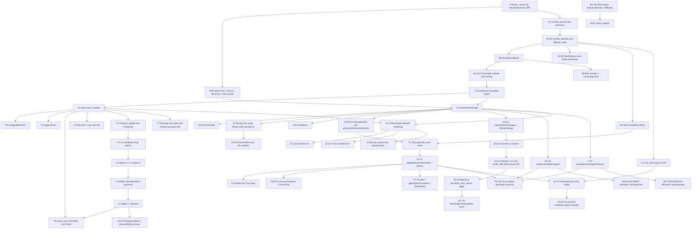

# HTML-in-Canvas: file map, concept inventory, dependency graph, gotchas, open questions

Research note 01 for the interactive learning site. Source material: `/Users/agharsallah/Desktop/git/html-in-canvas/docs-llm/`.

## 0. Read this first

**The folder layout differs from the brief.** `docs-llm/` has two sub-trees, not one:

- `docs-llm/git-official-docs/` is the WICG repo copy (README.md explainer, security-privacy-questionnaire.md, LICENSE.md, w3c.json, `Examples/`).
- `docs-llm/html-in-canvas-blogs/` is a markdown scrape of the **Chrome developer docs** (5 pages plus scraper metadata and 3 images). It is not in the brief, but it is prose and it is the only source for units, sizing, WebGL/WebGPU texture allocation, feature detection and library support. It also **disagrees with or extends** the README in several places. I inventory it in Part B of section 2 and flag divergences in section 5.

**Citation legend.** Every line number was taken from `cat -n` output.

| Prefix | File (under `docs-llm/`) |
|---|---|
| `R:` | `git-official-docs/README.md` (468 lines) |
| `S:` | `git-official-docs/security-privacy-questionnaire.md` (85 lines) |
| `CC:` | `html-in-canvas-blogs/concepts.md` (452 lines) |
| `2D:` | `html-in-canvas-blogs/2d.md` (104 lines) |
| `GL:` | `html-in-canvas-blogs/webgl.md` (142 lines) |
| `GPU:` | `html-in-canvas-blogs/webgpu.md` (136 lines) |
| `IDX:` | `html-in-canvas-blogs/index.md` (139 lines) |
| `EX:` | files under `git-official-docs/Examples/` (named explicitly) |

**Difficulty tags.** `beginner` = needed for any first demo. `intermediate` = needed to build something real. `advanced` = needed for 3D, workers, spec-level reasoning or security reasoning.

**"(inferred)"** marks a statement that no source states outright and that I derived from examples or surrounding text. Treat those as claims to verify before they go on the site.

---

## 1. File map

42 files (found with `find`, `.DS_Store` skipped). Relevance: **core** = a lesson should be built from it, **supporting** = useful context, **not relevant** = skip, with the reason.

### 1.1 Official repo copy: `docs-llm/git-official-docs/`

| Path | What it is | Why it matters / relevance |
|---|---|---|
| `git-official-docs/README.md` | The WICG explainer: motivation, five primitives, full IDL, demos list, read-back-allowed rendering, accessibility, OffscreenCanvas example, paint-timing alternatives, future work. | **Core.** The single most important file. Almost every concept below comes from here. |
| `git-official-docs/security-privacy-questionnaire.md` | The W3C TAG security and privacy self-review, 18 answered questions. | **Core** for the "why doesn't my cross-origin image paint?" lesson and for the read-back-allowed rationale. Short. |
| `git-official-docs/LICENSE.md` | W3C Software and Document License for reports, W3C CLA for contributions, W3C 3-clause BSD for tests. | Supporting. Only matters for the site's attribution and license footer if we quote the explainer. |
| `git-official-docs/w3c.json` | W3C repo metadata: group id 80485, contact `cwilso`, `repo-type: cg-report`. | Not relevant to learning. Confirms this is a Community Group report (WICG), not a standards-track Recommendation. |
| `git-official-docs/Examples/complex-text.html` | 2D demo (51 lines): one `drawable` div with multi-line text, emoji, RTL, vertical text, an `` and inline SVG, drawn rotated 15 degrees with `ctx.rotate/translate` scaled by `devicePixelRatio`. | **Core** (first 2D lesson). Shows `ctx.reset()` in `onpaint`, initial `requestPaint()`, and the device-pixel-content-box ResizeObserver. Uses the legacy `layoutsubtree` attribute next to `content="drawable"`. |
| `git-official-docs/Examples/pie-chart.html` | 2D demo (88 lines): three `drawable` labels (children of a `role="list"` canvas) placed at wedge midpoints, with `drawFocusIfNeeded` for the focus ring. | **Core.** Best demo for "drawn text that is still focusable and accessible" and for per-element automatic geometry. Uses `canvas.children`. |
| `git-official-docs/Examples/nested-sparkles.html` | 2D demo (99 lines): a `drawable` poem containing a nested `drawable` `<span>` that is drawn separately with sparkles behind it; continuous `requestPaint()` loop; `getInFlowRect` helper. | **Core** for nested drawables and the drawable-subtree exclusion rule. The helper shows the units pain (offsetLeft/Top times DPR). |
| `git-official-docs/Examples/webGL.html` | WebGL2 demo (386 lines): a flip-card with radio buttons and four translated message panes; `texImage2D` pre-allocation plus `texElementSubImage2D`; manual `updateElementGeometry` from the model-to-screen matrix; toggles `inert` on hidden faces; falls back to legacy `texElementImage2D`. | **Core** (advanced). The only demo of manual geometry in 3D. Needs `webGLSetup.js` and gl-matrix 2.8.1 from cdnjs. |
| `git-official-docs/Examples/webGLSetup.js` | Plain-WebGL boilerplate (311 lines): `loadShader`, `initShaderProgram`, buffers for a thin 2x2x0.2 box ("card"), `drawScene` (returns the point-to-screen matrix), attribute setup. | Supporting. Not HTML-in-Canvas-specific, but it is where the matrix that feeds `updateElementGeometry` comes from. |
| `git-official-docs/Examples/wolf.jpg` | 320x160 JPEG, 8 KB. | Supporting asset. Only used as the inline `` in `complex-text.html`. Same-origin, so it is allowed to paint (a cross-origin image would be excluded by read-back-allowed rendering). |

### 1.2 Jelly slider sub-project: `docs-llm/git-official-docs/Examples/webgpu-jelly-slider/` (20 files)

An adaptation of Software Mansion's TypeGPU "Jelly Slider" (credited in `index.html` and `LICENSE`). It is the only WebGPU demo. Only a tiny part is HTML-in-Canvas related, and the rest is a ray-marched jelly renderer.

| Path (under `Examples/webgpu-jelly-slider/`) | What it is | Relevance |
|---|---|---|
| `index.html` | Page (82 lines). Contains `<canvas content="drawable" layoutsubtree>` with a real `<input drawable id="slider" type="range">` (CSS `opacity: 0`) and `<div drawable id="value" inert>`. Heavy CSS for `prefers-color-scheme`, `prefers-contrast`, `forced-colors`. | **Core.** Shows an invisible but live, interactive `<input>` driving a WebGPU scene, and the `forced-colors` and system-color keywords (`Canvas`, `CanvasText`, `Highlight`) relevant to read-back rules. |
| `index.ts` (root) | Sandbox shell (about 275 lines): resizes canvases, builds a controls panel, then `await import('./src/index.ts')`. | Not relevant. Generic TypeGPU example scaffolding. |
| `src/index.ts` | The demo (955 lines): TypeGPU render pipelines, ray marching, TAA. Lines 773-820 are the HTML-in-Canvas part: `onpaint` calls `queue.drawElementImageToTexture({source}, {texture, size})`, with try/catch fallbacks to the legacy `copyElementImageToTexture`, then `updateElementGeometry` for both elements with a `DOMMatrix().translate(x, y)`. `requestPaint()` on slider `input` events (lines 103-107, 933). | **Core**, but read only lines ~60-110 and ~765-825 for the lesson. The remaining ~850 lines are GPU rendering. |
| `src/slider.ts` | `Slider` class (411 lines): bezier/SDF geometry and compute pipelines for the jelly body. | Not relevant (pure WebGPU rendering). |
| `src/taa.ts` | Temporal anti-aliasing resolve compute shader (124 lines). | Not relevant. |
| `src/camera.ts` | `CameraController` with Halton jitter for TAA (131 lines). | Not relevant. |
| `src/utils.ts` | Fresnel, Beer-Lambert, ray/box intersection, texture factories (68 lines). | Not relevant. |
| `src/constants.ts` | Rendering, lighting and jelly material constants (39 lines). | Not relevant. |
| `src/dataTypes.ts` | TypeGPU struct and bind-group layouts (64 lines). | Not relevant. |
| `src/numbers.ts` | `NumberProvider`: a 2D-canvas `fillText` atlas of "0 %".."100 %" glyphs (64 lines). Not imported by `src/index.ts` (no import found). | Not relevant. Likely an earlier non-HTML approach, since superseded by drawing the `#value` div. This is a nice contrast: the "before" state of the problem HTML-in-Canvas solves. |
| `src/events.ts` | `EventHandler` for mouse and touch drag on the canvas (94 lines). Not imported by `src/index.ts`. | Not relevant. The real input is the live `<input type=range>` now. |
| `src/common/defineControls.ts` | Types for the sandbox controls panel (62 lines). | Not relevant. |
| `src/common/setup-first-person-camera.ts` | TypeGPU sandbox first-person camera (177 lines). No import found in the demo. | Not relevant. |
| `src/common/setup-orbit-camera.ts` | TypeGPU sandbox orbit camera (249 lines). No import found in the demo. | Not relevant. |
| `package.json` | npm manifest (`typegpu ^0.10.2`, `vite ^6.1.1`, `typescript` aliased to `tsover`, `three`, `wgpu-matrix`, ...). | Not relevant to learning; note it uses npm, while this project's convention is pnpm. |
| `package-lock.json` | npm lockfile (about 62 KB). | Not relevant. |
| `vite.config.js` | Vite config with `unplugin-typegpu`; production `base` is `/html-in-canvas/Examples/webgpu-jelly-slider/` (GitHub Pages path); `build.target: 'esnext'` for top-level await. | Not relevant. Explains how the live demo is hosted. |
| `tsconfig.json` | TS config (ES2020, strict, `@webgpu/types`). | Not relevant. |
| `.npmrc` | One line: `registry=https://registry.npmjs.org/` (no trailing newline). | Not relevant. |
| `LICENSE` | MIT, (c) 2025 Software Mansion. | Supporting: attribution if the site reuses the jelly demo. |

### 1.3 Chrome developer docs scrape: `docs-llm/html-in-canvas-blogs/` (12 files)

Source: `https://developer.chrome.com/docs/web-platform/html-in-canvas` (see `manifest.json`).

| Path | What it is | Relevance |
|---|---|---|
| `html-in-canvas-blogs/index.md` | Overview page: what the API is, "Direct implementation" pointers, library support snippets (Three.js `HTMLTexture`, PlayCanvas, Babylon.js `HtmlTexture`, PixiJS `HTMLSource` v8.19.0, CanvasUI), coding-agent guidance. | **Core** for the "ecosystem" lesson. Also states the API shipped in Chrome 157 (`IDX:19`). |
| `html-in-canvas-blogs/concepts.md` | "Technical concepts": canvas prep, drawable subtree table, paint event, frame lifecycle, nested canvases, `requestPaint`, geometry, hit-test order, reset, **sizing and units**, accessibility, fallback strategies. | **Core.** The best learner-oriented prose; contains the CSS px vs canvas grid px units table (`CC:313-324`). |
| `html-in-canvas-blogs/2d.md` | 2D guide: the four `drawElementImage` overload forms, auto geometry, `preserveElementGeometry`. | **Core.** |
| `html-in-canvas-blogs/webgl.md` | WebGL guide: pre-allocate texture, `texElementSubImage2D`, manual geometry. | **Core.** |
| `html-in-canvas-blogs/webgpu.md` | WebGPU guide: `createTexture` usage flags, the full source and destination property tables, manual geometry. | **Core.** |
| `html-in-canvas-blogs/bundle.md` | All five pages concatenated (960 lines) with `<!-- url -->` markers at lines 5, 142, 591, 693, 833. | Not relevant: duplicate of the five pages above. Do not cite it. |
| `html-in-canvas-blogs/README.md` | Auto-generated "Documentation index" listing the five pages. | Not relevant (scraper output). |
| `html-in-canvas-blogs/AGENTS.md` | Auto-generated agent index ("Prefer retrieval-led reasoning...", `docs-md/html-in-canvas` root). Says it was written by `docs-to-md`. | Not relevant to learning. Confirms the scrape tool. |
| `html-in-canvas-blogs/manifest.json` | Scrape manifest: 5 pages, titles, depth, asset counts, char counts. `skipped: []`. | Not relevant. |
| `html-in-canvas-blogs/assets/canvas-dpr-diagram.1ba81153.png` | 4007x986 PNG: four-panel diagram of CSS / canvas / device grids and double anti-aliasing (referenced at `CC:276`). | Supporting: a ready-made explanation of the blur problem. Check Chrome docs licensing before reusing; redraw as our own SVG. |
| `html-in-canvas-blogs/assets/canvas-blurry-vs-crisp.4eb5b067.png` | 1760x555 PNG: blurry 300x150 grid vs crisp DPR-matched grid (`CC:282`). | Supporting (same caveat). |
| `html-in-canvas-blogs/assets/nmarkoborodova.0ae0b984.jpg` | 1530x1538 JPEG: the author's avatar. | Not relevant. |

**Not in the corpus:** the videos referenced by the blog pages (`drawable-subtree-demo.mp4`, `paint-event-demo.mp4`, `nested-canvas-demo.mp4`, `sync-geometry-demo.mp4`, `update-element-geometry-demo.mp4`; `CC:72, 106, 185, 222`, `2D:93`) were not scraped (they appear as empty `[ ](url)` links). The README's screenshots and the two Google Docs design links (`R:433`, `R:447`) are also external.

---

## 2. Concept inventory

Part A covers `README.md` and the security questionnaire, which is the brief. Part B covers concepts that exist **only** in the Chrome docs (`html-in-canvas-blogs/`). IDs (e.g. `B4`) are used by the dependency graph in section 3.

Entry format: **ID. Name** · difficulty · source location, then a plain-English explanation.

### Part A. README.md and security-privacy-questionnaire.md

#### A. Framing

**A1. The problem: no way to put rich HTML layout into canvas** · beginner · `R:9-11`
Today there is no web API for rendering complex laid-out text and other content into a `<canvas>`. Canvas-based UIs therefore lose accessibility, internationalization, performance and quality, because authors re-implement text layout, bidi, line breaking and so on by hand with `fillText`.

**A2. The five use cases** · beginner · `R:13-19`
(1) Styled, laid-out content in canvas (chart legends and axes, rich boxes in creative tools, in-game menus). (2) Accessibility improvements, since keeping a shadow DOM in sync with canvas draw calls is manual and error-prone today. (3) Composing HTML with effects, because CSS only offers a fixed set (`filter`, `backdrop-filter`, `mix-blend-mode`) while people want general WebGL shaders. (4) HTML rendering inside a 3D context (rich 2D surfaces in a 3D scene). (5) Media export (HTML to image or video).

**A3. "Five primitives"** · beginner · `R:23`
The README organizes the solution as five primitives: the `content` attribute (layout), the `drawable` attribute (what can be drawn), the `paint` event (DOM-to-canvas sync), `drawElementImage` and its WebGL/WebGPU cousins (drawing), and `updateElementGeometry` (canvas-to-DOM sync). Note this is a framing device. The real surface area is larger (see section 5, item 2).

**A4. Document status and provenance** · beginner · `R:5-7, 455-457, 459-468`; `EX` file `w3c.json`
It is a "living explainer", continuously updated, and a WICG Community Group report (`w3c.json`: `cg-report`). It links the security questionnaire as the only "other document" and lists eight authors (Rogers, Chenney, Harrelson, Jagenstedt, Zager, Sagar, Levin, Serboncini), all with Chromium or Igalia addresses. This is context for the "status" lesson: it is incubation, not a Recommendation.

#### B. Opting a canvas into layout: `content` and `drawable`

**B1. `content` attribute on `<canvas>`** · beginner · `R:26`, IDL `R:109-111`
A new enumerated attribute with two values: `fallback` (the default) means canvas children are the classic *fallback content* shown only when canvas is unsupported; `drawable` means the children take part in layout so they can be snapshotted and drawn. The IDL property is `attribute DOMString content`.

**B2. Reflection rules (`Reflect`, `ReflectOnly`, `ReflectMissing`, `ReflectInvalid`, `CEReactions`)** · intermediate · `R:109-111`
```idl
[CEReactions, Reflect, ReflectOnly=("fallback", "drawable"),
    ReflectMissing="fallback", ReflectInvalid="fallback"]
    attribute DOMString content;
```
`Reflect` means the JS property mirrors the content attribute. `ReflectOnly` limits the *returned* property value to the two known keywords. `ReflectMissing="fallback"` makes a missing attribute read as `"fallback"`. `ReflectInvalid="fallback"` makes any other string (a typo, or the empty string, since no `ReflectEmpty` is declared) read as `"fallback"`. `CEReactions` lets custom-element reaction callbacks fire when it changes. Practical consequence: `canvas.content === 'drawable'` is a usable feature test (the Chrome docs rely on this, `CC:428-435`), and in a browser without the API the property is simply `undefined`.

**B3. Fallback content (the default mode)** · beginner · `R:26`
In `fallback` mode canvas children behave exactly as before: they are not laid out and exist for assistive tech and non-supporting browsers. The new API is a mode switch, not a behavior change for existing pages.

**B4. Blockification of immediate children** · intermediate · `R:26`
With `content="drawable"`, the canvas "blockifies immediate descendants", meaning the CSS display-blockification rule is applied to the canvas's direct children (an inline child computes to a block-level display, like flex or grid items do). Only *immediate* descendants are mentioned; deeper inline content, such as the nested `<span drawable>` in `EX nested-sparkles.html:37`, stays inline.

**B5. Static positioning of children** · intermediate · `R:26`
Those immediate children "are laid out with static positioning", so they flow normally inside the canvas box and do not escape via `position: absolute`/`fixed` relative to the page. The exact mechanism (forced computed `position: static`? ignored offsets?) is not specified (section 5, item 4).

**B6. `content=drawable` descendants are "regular DOM" for accessibility, with no initial geometry** · intermediate · `R:26`
Descendants respect `aria-hidden="true"` and similar primitives, but initially have no geometry information. Full treatment under K.

**B7. Initially not hit-testable** · intermediate · `R:26`
Until an element's geometry is set (by `drawElementImage` in 2D, or `updateElementGeometry`), pointer events do not target it. This is why a drawn element appears but does not respond to clicks if you opt out of auto geometry or forget the manual call in 3D.

**B8. The `drawable` attribute** · beginner · `R:29`
A (boolean-style) attribute on canvas *descendants* that is "required for drawing". Only elements carrying it can be passed to `drawElementImage` and friends, and each one is an independent paint root. Note: there is **no IDL reflection** for `drawable` in the README (no `HTMLElement.drawable` property), so scripts use `hasAttribute`/`toggleAttribute`.

**B9. `drawable` implies `isolation: isolate`** · intermediate · `R:29`
A drawable element forms its own isolated stacking group, so its content composites internally and blend modes do not leak between the drawable and the rest of the page. This is what makes it a clean, self-contained snapshot.

**B10. `drawable` is a containing block for all descendants** · advanced · `R:29`
Like `transform` or `contain: paint`, a drawable establishes the containing block for descendants. In practice this means absolutely and fixed-positioned descendants are positioned relative to the drawable and are therefore captured inside its snapshot instead of escaping to the viewport (the README does not enumerate which `position` values it means).

**B11. Nesting and the drawable subtree definition** · intermediate · `R:29`
Drawables can be nested. A *drawable subtree* is "a drawable element and its descendants, excluding `drawable` descendants and their subtrees". So the snapshot of an outer drawable does **not** include any inner drawable (nor anything inside it); the inner one must be drawn by its own `drawElementImage` call.

**B12. What an excluded nested drawable leaves behind** · intermediate · (inferred) from `R:289`, `EX nested-sparkles.html:33-38, 47-61`, `CC:45-76`
The README never says what the outer snapshot shows where the nested drawable sits. In the nested-sparkles demo the poem is drawn without the word "you", the word's place in the line layout is preserved (the helper reads the span's `offsetLeft/Top/Width/Height`), and the span is then drawn separately on top. So the best reading is: the nested element keeps its layout space but paints nothing into the parent's snapshot.

#### C. The `paint` event

**C1. `paint` event and `onpaint`** · beginner · `R:32`, IDL `R:113`
`paint` is a new event dispatched on the `<canvas>`; `attribute EventHandler onpaint` is the handler property. It is the signal to redraw: "the DOM changed, here is a fresh snapshot, update the canvas". Handler code does the `ctx.drawElementImage(...)` calls.

**C2. Snapshots recorded every rendering update** · intermediate · `R:32, 37, 443`
On every rendering update the browser records "a snapshot of the rendering commands of all `drawable` elements, including their drawable subtrees". The snapshot is a recording of *painted output* (a display list), not the live DOM. `drawElementImage` draws "the last snapshot", so what you draw is always the most recently recorded state. (Whether it is re-rasterized at destination scale or resampled is unspecified, see section 5, item 14.)

**C3. When the event must fire (and may over-fire)** · intermediate · `R:32`
It "must fire if an element's snapshot would be drawn differently". Implementations "may fire the `paint` event when an element's snapshot has not changed, but should avoid doing so". So handlers must be idempotent and must not assume `changedElements` is non-empty.

**C4. Timing: just after the intersection-observer steps of update-the-rendering** · advanced · `R:32, 441-443`
The event fires "just after intersection observer steps have run during update-the-rendering" (HTML spec). That puts it after style/layout, ResizeObserver delivery and IntersectionObserver, and after the browser's own Paint step, so canvas drawing can be in sync with the DOM in the same frame. See L for why.

**C5. `changedElements`** · beginner · `R:32`, IDL `R:238-243`
The event "contains a list of the canvas `drawable` descendants which have changed". Declared as `[SameObject] readonly attribute FrozenArray<Element> changedElements`: a frozen array that returns the same object on every read. Use it to redraw or re-upload only what changed (the WebGL demo re-uploads a texture only if its element is in the list, `EX webGL.html:345-368`).

**C6. Canvas drawing now, DOM changes next frame** · intermediate · `R:32, 443`
"Canvas drawing commands made in the `paint` event will appear in the current rendering update, but DOM changes made in the `paint` event will not show up until the subsequent rendering update." The rendering update's DOM content is *locked in* before `paint` runs, and the drawn canvas content is the one intentional carve-out (`R:443`). Any style/DOM edit inside `paint` schedules another update, and a second `paint` if it changes a drawable's snapshot.

**C7. Reverse document order, reverse tree order** · advanced · `R:32`
To make sure "descendants paint before ancestors", `paint` events fire in reverse document order (child frames before their parent documents), and in reverse tree order within each document. This matters for nested canvases: the inner canvas fires, and draws, before the outer canvas, which can then draw the inner canvas's fresh pixels as part of a drawable (see `CC:125-187`).

**C8. `requestPaint()`** · beginner · `R:34`, IDL `R:115`
Causes the `paint` event to fire once at the next rendering opportunity, even if no drawable changed; analogous to `requestAnimationFrame`. It is the way to drive continuous animation (call it inside the handler) and to force an initial or post-resize paint. The demos all call it (`EX complex-text.html:44`, `pie-chart.html:80`, `nested-sparkles.html:64`, `webGL.html:374-376`).

**C9. `CanvasPaintEvent` and `CanvasPaintEventInit`** · advanced · `R:238-247`
```idl
[Exposed=Window] interface CanvasPaintEvent : Event {
  constructor(DOMString type, optional CanvasPaintEventInit eventInitDict);
  [SameObject] readonly attribute FrozenArray<Element> changedElements; };
dictionary CanvasPaintEventInit : EventInit { sequence<Element> changedElements = []; };
```
The constructor makes the event creatable from script (useful for tests and polyfills). It is window-only (`Exposed=Window`), so workers never see it. The init dictionary defaults `changedElements` to an empty sequence.

#### D. Drawing: `drawElementImage` and its overloads

**D1. `drawElementImage()` concept** · beginner · `R:37`
Draws the last snapshot of a `drawable` element, with its drawable subtree, into the 2D canvas. WebGL and WebGPU have counterparts that draw into a texture (H, I). Rendering starts at the element's border box before CSS transforms (D7).

**D2. Overload 1: `(element, dx, dy [, options])`** · beginner · `R:171-174`
Draws the whole element at its default size with its top-left corner at canvas-grid point (`dx`, `dy`).

**D3. Overload 2: `(element, dx, dy, dwidth, dheight [, options])`** · beginner · `R:176-180`
Draws the whole element scaled into a destination rect.

**D4. Overload 3: `(element, sx, sy, swidth, sheight, dx, dy [, options])`** · intermediate · `R:182-187`
Draws only a source sub-rectangle at its natural scale. The Chrome docs table (`2D:62`) states "drawn at that area's default size". It has no `dwidth/dheight`, so do not confuse this 7-number form with overload 2's 5-number form.

**D5. Overload 4: `(element, sx, sy, swidth, sheight, dx, dy, dwidth, dheight [, options])`** · intermediate · `R:189-195`
The full form: crop the source, then place and scale it. Mirrors the 9-argument `drawImage`.

**D6. Overload resolution and `unrestricted double`** · intermediate · `R:171-195`
All numeric parameters are `unrestricted double`, which means `NaN` and `+/-Infinity` are accepted by the IDL layer, as in `drawImage`, rather than throwing a TypeError. Forms are distinguished by argument count (3, 5, 7 or 9 numbers) with an optional trailing `DrawElementImageOptions`. What non-finite values do at runtime is not stated.

**D7. Origin: border box, before CSS transforms** · intermediate · `R:37, 44`
Drawing "starts at the element's border box, before CSS transformations". So (0,0) of the source is the top-left of the border box (padding and border included, margin excluded), and the element's own CSS `transform` is not applied to the snapshot you draw. Position, rotate and scale come from your `dx/dy/dwidth/dheight` and the canvas context's transform. The same reference frame is used for `canvasTransform` (F3b).

**D8. Source rect = outsets for clipping or ink overflow** · advanced · `R:37`
"The source rect parameters can be used to apply outsets to the drawn element, either for clipping or to include ink overflow extending beyond the element's border box." Ink overflow means painting outside the border box (box-shadow, outline, glyph overhang, filter blur). A source rect inside the border box clips; a rect extending beyond it (negative `sx/sy` or larger size) captures the overflow. By implication the default rect is the border box and overflow is not captured unless you ask for it (inferred).

**D9. Destination rect: position and scale** · beginner · `R:37`
"The destination rect parameters can be used to position and scale the drawn element." Units are canvas grid coordinates, not CSS pixels (see W14-W19 and the units table W17 in Part B).

**D10. Exceptions thrown by `drawElementImage`** · intermediate · `R:37`
"An exception is thrown if `drawElementImage()` is called with an element without the `drawable` attribute, before an initial snapshot has been recorded, or for elements with other canvas ancestors." Three failure cases: not drawable; no snapshot yet (e.g. called before the first `paint`); an element with other canvas ancestors (ambiguous, see section 5, item 6). The exception type is unspecified. The same checks presumably apply to `texElementSubImage2D` and `drawElementImageToTexture` (the sentence is in the paragraph about all three; inferred).

**D11. Argument type `(Element or ElementImage)`** · intermediate · `R:171-195`
Every drawing overload accepts either a live `Element` (uses its last snapshot) or an `ElementImage` previously captured (E). This is what lets a worker draw something it cannot reach through the DOM.

**D12. Mixin on both 2D contexts** · intermediate · `R:170, 198-199`
`interface mixin CanvasDrawElementImage`, included by `CanvasRenderingContext2D` and `OffscreenCanvasRenderingContext2D`. Not added to `ImageBitmapRenderingContext` or Path2D.

**D13. `DrawElementImageOptions.preserveElementGeometry`** · intermediate · `R:49, 162-168`
`boolean preserveElementGeometry = false`. When false, `drawElementImage` automatically calls `updateElementGeometry` with a `canvasTransform` mapping the border box to where it was drawn. When true, no automatic update occurs and you manage geometry yourself.

**D14. Automatic geometry update in 2D** · intermediate · `R:49, 164-166`
In a 2D context the browser can derive the geometry from the arguments you passed (and, per the Chrome docs, from the context's current transform and the element's style: `CC:216`), so `drawElementImage` auto-runs `updateElementGeometry`. This keeps hit testing, accessibility bounds and `getBoundingClientRect` aligned with what is painted. It is also why `EX pie-chart.html` and `complex-text.html` need no explicit geometry call even though the text is rotated.

#### E. `ElementImage` and `captureElementImage`

**E1. `captureElementImage(element)`** · intermediate · `R:39, 117`
`ElementImage captureElementImage(Element element)` on `HTMLCanvasElement` returns a reference to the element's most recent snapshot. It is the bridge to workers: capture in `paint`, transfer, draw there.

**E2. `ElementImage` interface** · intermediate · `R:249-252`
```idl
[Exposed=(Window,Worker), Transferable]
interface ElementImage { undefined close(); };
```
An opaque handle to one snapshot. `Exposed=(Window,Worker)` means it exists in both realms, and `Transferable` means it can be moved with `postMessage(msg, [elementImage])`. `close()` presumably releases the snapshot's memory early (conventional for `ImageBitmap.close()`); the README gives no prose on its semantics (section 5, item 9).

**E3. Transfer to a worker and draw into an `OffscreenCanvas`** · advanced · `R:39, 344-399`
"These objects can be transferred to a worker and drawn to an `OffscreenCanvas`." The README's worked example transfers a canvas with `transferControlToOffscreen()`, captures the form in `onpaint` and posts it with the transfer list, and draws it in the worker with `ctx.drawElementImage(e.data.form, 100, 0)`.

**E4. Only `ElementImage` crosses to workers** · advanced · `R:51, 142-146`
"Note that only `ElementImage` references may be passed from a worker": a worker has no `Element`s, so the worker-side `updateElementGeometry` accepts only `ElementImage`.

#### F. Synchronizing geometry (canvas to DOM)

**F1. Why geometry sync exists** · intermediate · `R:41-49`
Drawing is imperative and arbitrary (you can draw an element anywhere, scaled, rotated, or in 3D), so the browser cannot know from CSS where the element appears. `updateElementGeometry` tells the browser, so hit testing, accessibility bounds, layout queries and focus rings line up with the pixels.

**F2. `updateElementGeometry(element, options)`** · intermediate · `R:42, 119-122`
```idl
void updateElementGeometry((Element or ElementImage) element,
    optional UpdateElementGeometryOptions options = {});
```
"Allows manual geometry updates (primarily for WebGL/WebGPU)". Also exists on `OffscreenCanvas` (G2).

**F3. `UpdateElementGeometryOptions`** · intermediate · `R:85-101`
Three optional members: `preserveHitTestOrder`, `canvasClip`, `canvasTransform`. Omitted `canvasClip` and `canvasTransform` keep their pre-existing values.

**F3a. `preserveHitTestOrder` (default `false`)** · intermediate · `R:43, 86-90`
"If this is true and the element is already in the canvas's hit testing stack, do nothing. In all other cases, place the element at the top of the canvas's hit testing stack." So the default is "last updated wins the click"; `true` only protects an element that is already in the stack, and a new element is still pushed on top even with `true`.

**F3b. `canvasTransform` (`DOMMatrixInit`)** · intermediate · `R:44, 97-100`
The "canvas element transform": a matrix that maps the element's border box (before CSS transforms) to the drawn location in the canvas. It sets the element's DOM position and, when set, gives it a11y geometry. It "is not used for rendering", so changing it does not fire `paint`. Units: the README says "canvas" and (`R:49`) "the canvas's CSS coordinates"; the Chrome docs say CSS pixels (`CC:322`).

**F3c. `canvasClip` (`DOMRectInit`)** · advanced · `R:45, 92-95`
The "canvas element clip" used for **hit testing only**, "evaluated in the coordinate space of `canvasTransform`" (so it should follow the transform). Use it when only part of an element is drawn (e.g. a source-rect crop) so invisible parts do not take clicks. Like the transform it is not used for rendering and does not trigger `paint`. Which side of the transform that space is on is ambiguous (section 5, item 16).

**F4. The hit-test list and "skip intervening clips and transforms"** · advanced · `R:43`
The canvas keeps "an ordered list of drawable descendants to hit test". Hit testing "proceeds straight from the canvas element to each descendant, skipping intervening clips and transforms": it does not walk the DOM ancestry of each drawable, it just tests the geometry you registered, in list order (topmost = last).

**F5. Canvas geometry never triggers rendering** · intermediate · `R:44-45`
Both `canvasTransform` and `canvasClip` are interaction metadata, not paint inputs. Changing them alone will not cause a `paint`.

**F6. Setting a transform adds accessibility geometry** · intermediate · `R:44, 317`
Once a canvas element transform exists, "the element's accessibility information is updated to include geometry information". See K3.

**F7. `clearElementGeometry(element)`** · intermediate · `R:47, 124`
`void clearElementGeometry((Element or ElementImage) element)`. "Clears the above state" (the order-stack entry, transform and clip). The Chrome docs add that this un-draws the element without removing it from the DOM and marks it offscreen in the accessibility tree (`CC:249-256`). It also exists on `OffscreenCanvas` (G11).

**F8. `getElementTransform(element)`** · intermediate · `R:126-130`
`[NewObject] DOMMatrix getElementTransform(Element element)` returns the current border-box-to-canvas transform, "or an identity DOMMatrix if no transform has been set". Updated by `updateElementGeometry`, cleared by `clearElementGeometry`. Main-thread only (no `OffscreenCanvas` version, since it needs synchronous state). The PixiJS snippet in the Chrome docs calls it with two arguments (`IDX:116`), unlike this IDL (section 5, item 18).

**F9. `getElementImageDefaultSize` and `ElementImageDefaultSize`** · intermediate · `R:103-106, 136-139, 157-159`
```idl
dictionary ElementImageDefaultSize { double width; double height; };
ElementImageDefaultSize getElementImageDefaultSize((Element or ElementImage) element);
```
"The default size of the element in canvas grid coordinates." It is what you read to size a texture. Present on `HTMLCanvasElement` and `OffscreenCanvas` (so workers can size a destination from an `ElementImage`). Values are doubles, so the Chrome docs `Math.ceil` them (`GL:69-70`).

**F10. Why 3D contexts must call `updateElementGeometry` manually** · advanced · `R:49`
"3D contexts must call `updateElementGeometry` because, unlike 2D contexts, the transform from the element's drawn location in a texture to the canvas's CSS coordinates is not available in the canvas API." In 2D the browser can see the dx/dy plus the CTM. In WebGL/WebGPU the element is only copied into a texture, and your shader decides where it goes (any mesh, any projection), so only your code knows the transform.

**F11. Geometry feeds layout queries** · intermediate · (inferred) `R:385-388`, `CC:210-214`
The README's example comment says `form.getBoundingClientRect()` "would include an x translation of 100" after a worker draw. The Chrome docs list "layout queries such as `getBoundingClientRect()`" as a reason geometry matters.

#### G. OffscreenCanvas and worker batching

**G1. No synchronous DOM access on workers** · advanced · `R:51`
A worker cannot touch DOM APIs, so geometry cannot be applied inline when a worker-side 2D context calls `drawElementImage` (which would auto-update geometry) or `updateElementGeometry`.

**G2. `partial interface OffscreenCanvas`** · advanced · `R:141-160`
Adds `updateElementGeometry`, `clearElementGeometry` and `getElementImageDefaultSize`. There is **no** `getElementTransform`, `captureElementImage` or `requestPaint` on `OffscreenCanvas`.

**G3. Pending notification queue plus a microtask** · advanced · `R:51`
"The updates are added to an internal pending notification queue, and a microtask is queued to batch them."

**G4. Worker microtask posts a task to the main thread** · advanced · `R:51`
"On a worker thread, this microtask asynchronously posts a task to the main thread." So worker-side geometry changes are **asynchronous**: they land some time after the call.

**G5. Main-thread `OffscreenCanvas` is also batched** · advanced · `R:51`
"Main-thread `OffscreenCanvas` geometry updates are similarly batched via a microtask." (Meaning an OffscreenCanvas used on the main thread, with no cross-thread post.)

**G6. Atomic apply and the `elementgeometryupdate` event** · advanced · `R:51, 132-134, 385-388`
When the main-thread step completes, "the elements synchronously apply their geometry changes, and an `elementgeometryupdate` event is fired on the associated `HTMLCanvasElement` with a list of the elements that were updated". Handler property: `attribute EventHandler onelementgeometryupdate;` on `HTMLCanvasElement` ("Fired when the browser completes applying geometry updates originating from an OffscreenCanvas").

**G7. Removed elements are omitted from the event list** · advanced · `R:51`
"If an element no longer exists when the event fires, it is omitted from the list."

**G8. Why batch (the observer analogy)** · advanced · `R:51`
Batching, "as opposed to issuing a stand-alone update for each drawing API call, is similar to existing 'observer' APIs and ensures that updates are applied atomically without other tasks interleaving". One frame's worth of geometry changes arrives as a single consistent set.

**G9. `ElementGeometryUpdateEvent` and `ElementGeometryUpdateEventInit`** · advanced · `R:254-267`
```idl
[Exposed=Window] interface ElementGeometryUpdateEvent : Event {
  constructor(DOMString type, optional ElementGeometryUpdateEventInit eventInitDict = {});
  [SameObject] readonly attribute FrozenArray<Element> elements; };
dictionary ElementGeometryUpdateEventInit : EventInit { sequence<Element> elements = []; };
```
Same shape as `CanvasPaintEvent` but the list is `elements`, not `changedElements`. Note this constructor declares `= {}` for the init dictionary while `CanvasPaintEvent`'s does not.

**G10. OffscreenCanvas worked example** · advanced · `R:342-399`
Walk-through: create a worker from a Blob URL; `canvas.transferControlToOffscreen()`; post the offscreen canvas as transferable; in `onpaint`, `captureElementImage(form)` and post it as transferable; the worker does `ctx.reset()` then `drawElementImage(e.data.form, 100, 0)`; a ResizeObserver posts `width/height` scaled by `devicePixelRatio` and calls `canvas.requestPaint()`; `onelementgeometryupdate` signals the form's transform is now updated. Observations: (a) the resize needs `requestPaint()` since resizing a canvas clears it; (b) this example sizes with `contentRect * devicePixelRatio`, not the `device-pixel-content-box` approach used in the Basic Example (`R:75-79`); (c) the comment "x translation of 100" is only literally true at DPR 1 (section 5, item 17).

**G11. `OffscreenCanvas.clearElementGeometry`** · advanced · `R:153-155`
"Clears the element's geometry and fires `elementgeometryupdate` like `updateElementGeometry`", so clears are batched and notified the same way.

#### H. WebGL

**H1. `texElementSubImage2D`** · advanced · `R:36, 210-216`
```idl
partial interface WebGLRenderingContext {
  void texElementSubImage2D(GLenum target, GLint level, GLint xoffset, GLint yoffset,
      (Element or ElementImage) element, optional WebGLCopyElementImageConfig config = {}); };
```
Uploads the element's snapshot into a region of a bound 2D texture, like `texSubImage2D` for HTML. It takes an `Element` or an `ElementImage`.

**H2. `WebGLCopyElementImageConfig`** · advanced · `R:201-208`
Optional source rect (`GLfloat sx, sy, swidth, sheight`) and destination size (`GLsizei width, height`). None are `required` and none have defaults in the IDL. The Chrome docs give units and defaults: source rect in CSS px, `width/height` in texture pixels defaulting to the element's canvas-grid size rounded up (`CC:320-321`).

**H3. WebGL needs manual geometry** · advanced · `R:49`
See F10. The `EX webGL.html` demo computes a matrix from the card's model-to-screen projection each frame.

#### I. WebGPU

**I1. `GPUQueue.drawElementImageToTexture(source, destination)`** · advanced · `R:232-236`
Copies the snapshot into a `GPUTexture` via two dictionaries.

**I2. `GPUDrawElementImageSource`** · advanced · `R:224-230`
`required (Element or ElementImage) source;` plus optional `float sourceX, sourceY, sourceWidth, sourceHeight` (the source rect; the Chrome docs say "all four or none", `GPU:68-71`).

**I3. `GPUDrawElementImageDestination`** · advanced · `R:218-222`
`dictionary GPUDrawElementImageDestination : GPUImageCopyTextureTagged { GPUExtent3D size; };`. The README note says `GPUImageCopyTextureTagged` extends `GPUTexelCopyTextureInfo`, which has a required `GPUTexture texture`. So the destination inherits `texture`, `mipLevel`, `origin`, `aspect`, `colorSpace`, `premultipliedAlpha` and adds `size`. The Chrome docs table lists these with defaults (`GPU:75-83`). The base type name may be stale against the current WebGPU spec (section 5, item 23).

#### J. Read-back-allowed rendering (README) `R:293-313`

**J1. The principle** · intermediate · `R:295`
`drawElementImage()`, "any other methods that draw element image snapshots, as well as the paint event, must not reveal any security- or privacy-sensitive information that isn't otherwise observable to author code". Called read-back-allowed rendering because it is safe to let scripts read the pixels back. The README notes pixel read-back "is always possible with WebGL and WebGPU", so the snapshot must contain nothing the page could not already learn (my elaboration: unlike a classic 2D canvas, which can be *tainted* and then refuses `getImageData`).

**J2. Two leak channels: painting and invalidation** · advanced · `R:297`
Painting leaks through "canvas pixel readbacks or timing attacks"; invalidation leaks through `onpaint` (if the event fires only when something visible changed, firing alone reveals that something changed). So sensitive information is excluded from both painting and invalidation. `S:15` repeats that "disabling painting of this information also prevents revealing invalidation information via the `paint` event".

Sensitive information that must be excluded (`R:299-307`), one entry each. The README only *lists* these; the "why" sentences below are my explanation, not source text:

**J3. Cross-origin data in embedded content** · intermediate · `R:300`
Cross-origin content in `<iframe>`, `` and other embedded content. Same-origin iframes "would still paint, but cross-origin content in them would not".

**J4. Cross-origin `<url>` references** · intermediate · `R:300`
CSS values such as `background-image` and `clip-path` that reference a cross-origin URL.

**J5. Tainted `<canvas>` elements** · intermediate · `R:300`
A canvas inside the drawable that holds cross-origin pixels.

**J6. Cross-origin-capable SVG references** · advanced · `R:300`
SVG features that pull external resources: `<use>`, `<pattern>`, `<feImage>`.

**J7. System colors, themes, preferences** · advanced · `R:301`
Painted output must not reveal OS theme colors, system color keywords' real values or user preferences (but see J14 on `forced-colors`).

**J8. Spelling and grammar markers** · intermediate · `R:302`
The red/blue squiggles are user-specific (they reveal dictionary contents) and are not drawn.

**J9. Visited link information** · intermediate · `R:303`
`:visited` styling is not painted, defeating the classic history-sniffing attack through pixel or invalidation timing.

**J10. Pending form autofill information** · intermediate · `R:304`
Autofill previews "not otherwise available to JavaScript" are not painted.

**J11. Subpixel text anti-aliasing** · advanced · `R:305`
LCD/subpixel AA reveals the user's display subpixel layout (a fingerprinting signal), so text in snapshots uses grayscale AA and may look slightly different from DOM text.

**J12. Captions and video controls** · intermediate · `R:306`
Browser-drawn media UI is excluded.

**J13. IME pop-ups and distinctive IME text formatting** · advanced · `R:307`
In-progress input-method composition UI and underline/highlight styles are excluded (they reveal the user's input method and composing state).

Information that is explicitly **not** considered sensitive (`R:309-313`):

**J14. Find-in-page and text-fragment markers** · intermediate · `R:310`
"Search text (find-in-page) and text-fragment (fragment url) markers" may appear in snapshots.

**J15. Scrollbar and form-element appearance** · intermediate · `R:311`
Native scrollbars and form controls (checkbox, range, etc.) are painted. Justification: "these are already detectable in Blink and WebKit through foreignObject" (a jsfiddle is linked).

**J16. Caret blink rate** · intermediate · `R:312`
Revealed, since the caret has to look alive for interactivity. `S:4, 29` acknowledge this as the main new platform-derived datum.

**J17. `forced-colors`** · advanced · `R:313`
Not sensitive because "this information is already available to javascript using the `forced-colors` media query and system colors". (Tension with J7, section 5, item 28.)

#### K. Accessibility `R:315-340`

**K1. Exposed like regular DOM** · beginner · `R:317`
Content under `<canvas content="drawable">` is in the accessibility tree "unless this is modified with accessibility primitives like `aria-hidden="true"`, `inert`, etc.". The semantics come from the real DOM, not from the pixels.

**K2. Geometry-less accessibility nodes (the one special case)** · intermediate · `R:317`
If a `drawable`'s geometry has never been updated (neither automatically via `drawElementImage` nor explicitly via `updateElementGeometry`), "the `drawable` element and its drawable subtree are reported to the accessibility tree without geometry information".

**K3. Rationale: keep semantics, let tools filter** · intermediate · `R:317`
This "ensures that accessibility does not lose the semantic information of content outside a `drawable` subtree, or in a `drawable` subtree but without updated geometry. This allows for assistive technologies to filter out content without geometry information." (A screen reader can still read it; a magnifier can ignore it.)

**K4. Hide or remove unused content** · intermediate · `R:317`
"It is important that the accessibility aspects of unused canvas descendants, such as hidden views or no-longer-drawn content, are considered, and in many cases these should be removed from the DOM or hidden using accessibility primitives like `aria-hidden="true"`." The WebGL demo toggles `inert` on the face that is turned away (`EX webGL.html:108-128`).

**K5. Focus indicators and carets are rendered into the snapshot** · intermediate · `R:319`
"Accessibility indicators such as focus or carets will be rendered with `drawElementImage` (and similar WebGL/WebGPU APIs)". So the blinking cursor in the Basic Example appears in the canvas with no extra work.

**K6. Figure/image/caption example** · intermediate · `R:321-340`
`<figure>` (not drawable) contains `` and `<figcaption drawable>`; each drawable is drawn at different canvas positions. Semantics stay intact (figure -> image + caption), and because `preserveElementGeometry` defaults to false, each `drawElementImage` call also gives its element geometry. This shows that `drawable` need not be on the semantic parent.

#### L. Alternatives and future work `R:401-453`

**L1. Why a new event is needed** · intermediate · `R:403`
Developers need an opportunity to update canvas rendering in response to paint changes, integrated into update-the-rendering so canvas and DOM stay in sync.

**L2. Candidate firing points** · advanced · `R:405-423`
Steps of HTML update-the-rendering listed: 14 animation frame callbacks, 16.2.1 recalc style/layout, 16.2.6 deliver resize observers (loop back to 16.2.1 if needed), 19 intersection observations, then the unnamed Paint step (compute painted output), then the unnamed Commit/thread handoff. Option A, B and C are positioned relative to these.

**L3. "paint event" vs "Paint step"** · intermediate · `R:425`
The `paint` event is the new canvas event. The Paint step is the browser's existing operation that records painted output "following paint order". Easy to conflate.

**L4. Option A: fire at ResizeObserver timing, loop if needed** · advanced · `R:427-433`
Like ResizeObserver, loop back to style/layout if the handler modified DOM (including outside the canvas), because "there is no mechanism for preventing arbitrary javascript from modifying the DOM". Looping would trigger on more conditions than ResizeObserver (e.g. background style changes), and canvas code may run multiple times per frame. Two sub-options: (1) a synchronous Paint step to snapshot drawables, which may be expensive and run repeatedly, with unique implementation challenges in Gecko; (2) record a **placeholder** for how the element will look next update and substitute the real rendering at the next Paint step (a design doc is linked).

**L5. Why placeholders fail for WebGL: the flush/deadlock argument** · advanced · `R:433`
The placeholder model works for 2D by buffering canvas commands until the next Paint. `getImageData` needs a synchronous flush and would then show blank/stale data for placeholders. But for WebGL "many APIs require flushing (e.g., `getError()`, see callsites of WaitForCmd)", and calling any of them "would result in a deadlock or inconsistent rendering", since the GPU command buffer is waiting on content that is not painted yet. Conclusion: "we must run the `paint` event at a time where we have the complete painted display list of an element already available."

**L6. Option B: fire right after Paint, loop if needed** · advanced · `R:435-439`
Avoids partial Paint of drawables (an upside over A) but is worse in that more update-the-rendering steps re-run on every loop iteration, plus the same looping downsides.

**L7. Option C: fire right after Paint, once (selected)** · advanced · `R:441-443`
Runs `paint` once per rendering update, like the browser's own Paint. To solve the problem of arbitrary JS modifying the DOM, the rendering update's contents are locked in before `paint` runs, with "one intentional carve-out: the drawn content of the canvas". DOM invalidations in `paint` apply to the **subsequent** update. This is the origin of gotcha "DOM edits in paint show next frame".

**L8. Alternative: worker-thread threaded effects** · advanced · `R:445-447`
Send drawable snapshots to a worker, which re-renders them into `OffscreenCanvas` during threaded scroll/animation. Rejected because it needs JS to be callable synchronously on scroll and animation updates, "which is difficult for architectures that perform threaded scroll updates in a restricted process" (a design doc is linked).

**L9. Future: auto-updating canvas** · advanced · `R:449-453`
`drawElementImage` would record a *placeholder* for the latest rendering; the canvas would keep a command buffer that is auto-replayed after every scroll or animation update, so effects stay in sync with native scrolling/animation "independent of the main thread". "Viable for 2D contexts, and may be viable for WebGPU with some small API additions" (WebGL is conspicuously not mentioned, consistent with L5).

#### M. README demos `R:269-291`

**M1. Five live demos plus a three.js variant** · beginner · `R:269-291`
(1) `complex-text.html`: rotated complex text via `drawElementImage`. (2) `pie-chart.html`: pie chart with multi-line labels. (3) `webgpu-jelly-slider/`: WebGPU `drawElementImageToTexture` for a div under a jelly slider. (4) `webGL.html`: WebGL `texElementSubImage2D` onto a 3D card. (5) `nested-sparkles.html`: nested drawables. A three.js experimental `htmlTexture` demo (and PR 31233) is linked (`R:287`). Live URLs are under `wicg.github.io/html-in-canvas/Examples/`.

#### N. README code patterns `R:53-81`

**N1. The Basic Example** · beginner · `R:53-81`
`<canvas content="drawable"><form drawable>...</form></canvas>`; `canvas.onpaint = () => { ctx.reset(); ctx.drawElementImage(form, 100, 0); }`; and a ResizeObserver sizing the grid. The screenshot shows a form with a blinking caret. It never calls `requestPaint()` (section 5, item 12).

**N2. `ctx.reset()` at the top of `onpaint`** · beginner · `R:71, 336, 368`
Every example clears with `ctx.reset()` (clears the bitmap and restores default state) so each paint is a full redraw and transforms do not accumulate across frames.

**N3. Sizing the grid with `devicePixelContentBoxSize`** · intermediate · `R:75-79`
```js
new ResizeObserver((entries) => {
  canvas.width  = entries[0].devicePixelContentBoxSize[0].inlineSize;
  canvas.height = entries[0].devicePixelContentBoxSize[0].blockSize;
}).observe(canvas, { box: 'device-pixel-content-box' });
```
The comment "Size the canvas grid to match the device scale factor." is the only unit guidance in the README. The consequences (grid pixels vs CSS pixels) are developed in the Chrome docs (Part B).

#### O. Security and privacy questionnaire (`S:`)

Numbering in the file: 01-06, then 8-19. **There is no item 7** (section 5, item 29). Wording is the file's own.

| # | Question (short) | Answer in the file | Lines | Difficulty |
|---|---|---|---|---|
| 01 | What information is exposed and why? | A design requirement is to expose **no new security information** and to limit new privacy information (links read-back-allowed rendering). For interactivity it reveals form-control rendering, scrollbar rendering, text selection, find-in-page selection and caret blink rate, "all without revealing OS theme colors". | `S:1-4` | intermediate |
| 02 | Minimum information necessary? | "Yes." (no justification given) | `S:6-9` | beginner |
| 03 | Personal information / PII? | Pixels from DOM now reach script, so no PII may be in them. Cross-origin info, visited-link info, spellcheck info and autofill previews "must not be painted". Disabling painting also prevents leaking invalidation via `paint`. | `S:11-15` | intermediate |
| 04 | Sensitive information? | Refers back: no new security information, limited new privacy information. | `S:17-19` | beginner |
| 05 (file's number; likely standard TAG Q6) | New state persisting across browsing sessions? | "No." | `S:21-24` | beginner |
| 06 (likely standard Q7) | Exposes underlying-platform information? | Painting of platform-revealing info (e.g. form autofill) is disabled, but some platform info is revealed for interactivity, e.g. the caret blink rate. | `S:26-29` | intermediate |
| 8 | Lets an origin send data to the underlying platform? | "No." | `S:31-34` | beginner |
| 9 | Access to device sensors? | "No." | `S:36-38` | beginner |
| 10 | New script execution/loading mechanisms? | "No." | `S:40-43` | beginner |
| 11 | Access to other devices? | "No." | `S:45-47` | beginner |
| 12 | Control over the UA's native UI? | "No." | `S:49-52` | beginner |
| 13 | Temporary identifiers created or exposed? | "None." | `S:54-57` | beginner |
| 14 | First-party vs third-party contexts? | "There is no difference in behaviour." | `S:59-62` | intermediate |
| 15 | Private Browsing / Incognito? | "There is no difference in behaviour for these modes." | `S:64-67` | beginner |
| 16 | Separate "Security Considerations" and "Privacy Considerations" sections? | The read-back-allowed rendering spec was split into its own PR (`whatwg/html#12554`), whose text says it is used "so that security- or privacy-sensitive information, such as cross-origin data, is not exposed". | `S:69-72` | advanced |
| 17 | Lets origins downgrade default security protections? | "No." | `S:74-77` | beginner |
| 18 | Non-"fully active" documents? | "It only works in fully active documents." | `S:79-82` | advanced |
| 19 | What should this questionnaire have asked? | "No suggestions." | `S:83-85` | beginner |

Concept-level takeaways to teach from the questionnaire: the **design rule** (no new security info, minimal privacy info; `S:4`), the **purpose-for-exposure** trade (interactivity requires some leaks such as caret blink rate; `S:4, 29`), the **invalidation-is-a-channel** idea (`S:15`), **no persistence/sensors/devices/identifiers** (`S:21-57`), and **no first-party/third-party or private-mode behavior difference** (`S:59-67`).

### Part B. Concepts found only in the Chrome docs (`html-in-canvas-blogs/`)

These do not appear in the README (or only in one sentence). They are the **practical** layer (units, texture allocation, sizing) and should anchor the "build it for real" lessons. IDs use a `W` prefix.

| ID | Concept | Explanation | Where | Difficulty |
|---|---|---|---|---|
| W1 | Shipped in Chrome 157 | The API "shipped in Chrome 157, and it might not be supported in all browsers". The README has no ship status. Other engines' status is not stated anywhere in the corpus. | `CC:426`, `IDX:19` | beginner |
| W2 | Feature detection | Create a canvas, `setAttribute('content','drawable')`, then check `canvas.content === 'drawable'`. Works because of reflection (B2); an unsupporting browser has no `content` property. | `CC:428-435` | beginner |
| W3 | Fallback strategies | Alternatives when unsupported: an alternative UI, floating HTML overlays, the `three-html-render` library, `html2canvas`, `dom-to-image`. | `CC:437-443` | beginner |
| W4 | The two-attribute setup | `content="drawable"` on the canvas "opts the canvas into laying out its descendant DOM nodes"; `drawable` on a target "marks an element as an independent paint root". | `CC:29-43` | beginner |
| W5 | Drawable-subtree table | Parent subtree = background panel + heading + paragraph; nested child subtree = button surface and text, drawn by its own call. "Nesting lets you maintain semantic HTML relationships while giving you the freedom to layer, position, or animate child elements independently." | `CC:45-76` | intermediate |
| W6 | What counts as "changed" | `paint` is dispatched "whenever layout, text, or CSS styles change on any of its `drawable` descendants"; `changedElements` includes style changes, layout shifts, text edits and **focus-state changes**. | `CC:80, 93-102` | beginner |
| W7 | `addEventListener('paint')` equals `onpaint` | Both styles are shown (`canvas.addEventListener("paint", ...)` vs `canvas.onpaint = ...`). | `CC:83, 364`, `2D:33` | beginner |
| W8 | Frame lifecycle snippet | Drawing in `paint` renders in the current update; a style change in the same handler "schedules a new layout cycle" and appears next frame. | `CC:110-123` | intermediate |
| W9 | Nested canvases | A `<canvas content=drawable>` inside a `drawable` wrapper inside another canvas. The nested canvas's `paint` fires first, then the parent's, which draws the wrapper (now containing the freshly painted inner canvas). | `CC:125-187` | advanced |
| W10 | Animation loop | `requestPaint()` inside the `paint` handler yields a per-frame loop; call it once more outside to start. | `CC:189-206` | beginner |
| W11 | Why geometry matters (three reasons) | Hit testing (clicks, taps, pointer), layout queries (`getBoundingClientRect()`), accessibility bounds (magnifiers). In 2D, args plus computed style plus the context's current transform suffice; in WebGL/WebGPU the browser cannot know. | `CC:210-218` | intermediate |
| W12 | Hit-test stacking default | "By default, every time an element's geometry is updated, the browser brings it to the top of the interaction stack (last drawn = topmost click target)". Table: `preserveHitTestOrder: false` brings to top (foreground); `true` leaves stack priority (backdrops updated late). | `CC:232-247` | intermediate |
| W13 | Un-drawing | `clearElementGeometry(el)` "resets the element's canvas transform and marks it as offscreen in the accessibility tree" and removes it from canvas hit testing. | `CC:249-256` | intermediate |
| W14 | Three coordinate systems | CSS px (layout), device px (raster, = CSS px x `devicePixelRatio`), and the **canvas grid** (`canvas.width/height`, separate from both). Browsers *snap* boxes and borders to whole device pixels and *anti-alias* glyphs and curves. | `CC:260-267` | intermediate |
| W15 | Why mismatched grids blur | Content passes through two conversions (CSS to grid, grid to device) and every non-1:1 step re-blends: the edge is anti-aliased once into the coarse grid and again when the grid is stretched. Worked example: 360x180 CSS px canvas, 300x150 grid, DPR 1.5, so 540x270 device px; fix = a 540x270 grid. Two images illustrate it. | `CC:269-284` | intermediate |
| W16 | Size the grid with ResizeObserver | Do not hard-code. Use `devicePixelContentBoxSize` (box `'device-pixel-content-box'`) with a fallback of `Math.round(contentRect * devicePixelRatio)`; feature-check `'devicePixelContentBoxSize' in ResizeObserverEntry.prototype`. The size changes with layout, zoom and moving windows between displays. | `CC:286-304` | intermediate |
| W17 | **Units table** | Grid px: `canvas.width/height`, 2D draw params (`dx, dy, dwidth, dheight`), `getElementImageDefaultSize()`. **CSS px**: source rects (`sx, sy, swidth, sheight`, `sourceX/Y/Width/Height`), `getElementTransform()`, `canvasTransform`, `canvasClip`, all DOM measurements (`offsetWidth`, `getBoundingClientRect()`, pointer `offsetX`, `contentBoxSize`). Texture px: `texElementSubImage2D` `width/height` and `drawElementImageToTexture` `size` (default = element size in grid px, rounded up). Device px: `devicePixelContentBoxSize`. | `CC:313-324` | intermediate |
| W18 | scaleX/scaleY conversion recipe | `scaleX = canvas.width / cssContentWidth` (and Y), computed inside the ResizeObserver; multiply CSS values by it before drawing, e.g. to center `card.offsetWidth * scaleX`. | `CC:326-377` | intermediate |
| W19 | `box-sizing: border-box` tip | Because the **border box** is what is drawn, use `box-sizing: border-box` so a CSS `width: 200px` with padding draws 200 px wide rather than 232. | `CC:379-388` | beginner |
| W20 | When an element "lacks geometry" | Two conditions: never drawn via `drawElementImage()` (which auto-updates) and never given `updateElementGeometry()`. Then the element and its subtree are reported without geometry. Benefit: "screen readers access the semantic content, while signaling visual assistive tools (like magnifiers) to filter out the undrawn elements". | `CC:392-399` | intermediate |
| W21 | 2D guide: three steps | (1) Prepare the canvas (same for 2D/WebGL/WebGPU), (2) draw the element image, (3) optionally synchronize DOM and pixels. In 2D the browser "automatically synchronizes layout coordinates, accessibility bounds, and pointer hit-testing". | `2D:17-21, 65-69` | beginner |
| W22 | Overload table | Four rows: default size; custom destination box; cropped at default size; source slice to destination. | `2D:42-63` | beginner |
| W23 | Manual geometry in 2D | Draw with `{ preserveElementGeometry: true }`, then build a `DOMMatrix` yourself (`a = scale`, `e = x / scaleX`, `f = y / scaleY`, converting grid px to CSS px) and call `updateElementGeometry(el, { canvasTransform })`. The linked video shows geometry going out of sync when you opt out. | `2D:71-95` | intermediate |
| W24 | WebGL: pre-allocate storage | `texElementSubImage2D` is a *sub*-image upload, so allocate first with `gl.texImage2D(TEXTURE_2D, 0, RGBA8, w, h, 0, RGBA, UNSIGNED_BYTE, null)`; do it once, or when the element's size changes. Size it from `getElementImageDefaultSize()` with `Math.ceil`. Reason: "fast sub-image updates without triggering expensive GPU memory re-allocations". | `GL:31-76` | advanced |
| W25 | WebGL: upload in `paint` | Bind the texture, then `texElementSubImage2D(TEXTURE_2D, 0, 0, 0, element)`; the element may also be an `ElementImage` from `captureElementImage()`. | `GL:78-98` | advanced |
| W26 | WebGL: geometry order in the handler | In `paint`: upload texture, draw the 3D scene, then build a `DOMMatrix` (`a = canvas.clientWidth / el.offsetWidth`, `d` likewise, `e/f` = translate in CSS px) and call `updateElementGeometry`. The comment says this updates "DOM position, accessibility focus rings, and pointer hit-testing". | `GL:100-133` | advanced |
| W27 | WebGPU: allocate with `createTexture` | "WebGPU requires explicit memory allocation": `device.createTexture({ size, format: 'rgba8unorm', usage: TEXTURE_BINDING \| COPY_DST \| RENDER_ATTACHMENT })`. Size from `getElementImageDefaultSize()` with `Math.ceil`. | `GPU:31-57` | advanced |
| W28 | WebGPU source and destination properties | Source: `source` (required Element/ElementImage), `sourceX/Y/Width/Height` (CSS px, "all four or none"). Destination: `texture` (required), `size` (physical texture px), `origin` (default `[0,0,0]`), `mipLevel` (0), `aspect` (`"all"`), `colorSpace` (`"srgb"`), `premultipliedAlpha` (false). | `GPU:59-83` | advanced |
| W29 | WebGPU geometry recipe | Convert grid-px sizes back to CSS px by dividing by `scaleX/scaleY`, then `new DOMMatrix().translate(x, y)` and `updateElementGeometry`. | `GPU:109-127` | advanced |
| W30 | Library support | Three.js `THREE.HTMLTexture(uiElement)` (PR 31233); PlayCanvas texture API (`htmlTexture.setSource` inside a one-shot `paint`, plus `requestPaint()`); Babylon.js `BABYLON.HtmlTexture`; PixiJS `HTMLSource({ resource, autoUpdate: true })` shipped in v8.19.0 (the HTML element is appended as a *child of the Pixi canvas*, and the ticker syncs the CSS transform with `getElementTransform(...)`); CanvasUI component library. Rationale: "Updating matrixes manually can be tedious, so frameworks are adding built-in support." | `IDX:36-125` | intermediate |
| W31 | Agent tooling and community | "Modern Web Guidance" for coding agents; a community demo collection (`GoogleChromeLabs/css-web-ui-demos`); the GitHub issue tracker for feedback. | `IDX:28, 127-139` | beginner |
| W32 | The "stale geometry" demo | Video caption: "When the code stops calling `updateElementGeometry()`, the browser no longer knows where the HTML elements on the 3D card are. The card keeps turning, but clicks still land where it used to be." (video not scraped). | `CC:224` | intermediate |

---

## 3. Concept dependency graph

Arrows mean "must be understood before". Node labels use the IDs from section 2. Prerequisite outside knowledge: canvas basics (`getContext('2d')`, the `width/height` grid), CSS pixels, `ResizeObserver`, `devicePixelRatio`, the browser's rendering-update loop, and, for 3D, matrices and textures.



### Suggested teaching order (flattened)

1. **Tier 0 (orientation):** A1-A3, M1 (what it looks like), W1-W3.
2. **Tier 1 (declare):** B1-B3, B8, B11-B12, then B4-B5, B9-B10 as "layout facts".
3. **Tier 2 (units, before any drawing lesson):** W14-W19. Without this, learners misplace everything.
4. **Tier 3 (draw):** C1, C2, D1-D6, N1-N3, then D7-D9, D10, C8.
5. **Tier 4 (the frame loop):** C3-C6, C5, W6-W10; paint-timing alternatives L1-L7 as a "why it works this way" appendix after C6.
6. **Tier 5 (the DOM stays alive):** B7, F1, D13-D14, K1-K6, F2-F9, W11-W13, W23.
7. **Tier 6 (nesting):** B11-B12 revisited, C7, W9.
8. **Tier 7 (3D):** F10, H1-H3, I1-I3, W24-W29.
9. **Tier 8 (workers):** E1-E4, G1-G11.
10. **Tier 9 (trust model):** J1-J17, O, then L8-L9 and W30 as "where it is going".

Hard prerequisite edges worth enforcing in the site's progress gating: `W14-W19` before any `D*` exercise; `C6` before `F*`; `F10` before `H*`/`I*`; `E*` before `G*`; `J1-J2` before J3-J17.

---

## 4. Gotchas and misconceptions

Each item names what learners are likely to get wrong, why, and where it is grounded. "(inferred)" marks claims that are not stated outright in the sources.

### 4.1 Units and sizing

**X1. Three coordinate systems, and the default grid is wrong.** A canvas that is not resized keeps the default 300x150 grid, which is stretched over the CSS box and looks blurry (`CC:260-284`; the image alt text at `CC:282` says "drawn on the default 300 by 150 canvas grid, looking blurry"). Learners will assume `width: 400px` in CSS also sets the drawing surface. Fix: size the grid with a ResizeObserver on `device-pixel-content-box` (`R:75-79`, `CC:286-304`).

**X2. `dx`/`dy` are canvas grid px, but `sx`/`sy` and geometry are CSS px.** `dx, dy, dwidth, dheight`, `getElementImageDefaultSize()` and `canvas.width/height` are grid pixels; source rects, `canvasTransform`, `canvasClip` and `getElementTransform()` are CSS pixels; `offsetWidth`, `getBoundingClientRect()` and pointer coordinates are CSS pixels (`CC:313-324`). The README never states this, so anyone working from the README alone will mix them. The demos paper over it with `* devicePixelRatio` (`EX pie-chart.html:67-68`, `nested-sparkles.html:54, 87-90`, `complex-text.html:41`); that is only correct when the grid is exactly device pixels (use `scaleX/scaleY`, `CC:326-356`).

**X3. Resizing the canvas clears it.** Assigning `canvas.width/height` resets the bitmap and context state (standard canvas behavior; inferred as the reason the OffscreenCanvas example calls `canvas.requestPaint()` right after resizing, `R:391-397`). In the Basic Example the ResizeObserver runs before the `paint` step of the same frame, so it works there, but a resize with no pending paint leaves a blank canvas.

**X4. The README's ResizeObserver example is not robust.** `entries[0].devicePixelContentBoxSize[0]` throws if the browser lacks `devicePixelContentBoxSize` (`R:77-78`, copied in every demo). The Chrome docs guard it with a feature check and a `contentRect * devicePixelRatio` fallback (`CC:290-304`). The README's OffscreenCanvas example uses only the fallback style (`R:391-397`).

**X5. Border box, not content box.** The draw starts at the border box (`R:37`). With default `box-sizing: content-box`, `width: 200px` plus padding draws wider than 200. Use `box-sizing: border-box` (`CC:379-388`). Margins are not part of the drawing.

**X6. Context state accumulates across paints.** Demos call `ctx.reset()` first (`R:71`; `EX complex-text.html:39-41` then `rotate` and `translate`). Without it (or `save/restore`), transforms compound frame after frame.

### 4.2 The frame loop

**X7. DOM edits inside `paint` appear one frame later.** Canvas draws made in the handler show now; style/DOM changes made there wait for the next rendering update (`R:32, 443`; `CC:112-123`). A handler that unconditionally mutates a drawable's style can re-trigger `paint` every frame.

**X8. `requestPaint()` inside `paint` is an unconditional loop.** It schedules a paint at every rendering opportunity even if nothing changed, and `changedElements` will then be empty (`R:34`, `CC:189-206`). Only loop while animating.

**X9. `paint` is not `requestAnimationFrame`.** It fires only when a drawable's snapshot would differ or `requestPaint()` was called, and it runs late in the update (after layout, ResizeObserver and IntersectionObserver steps, `R:32`), not at rAF time (step 14, `R:407`). It may also fire spuriously (`R:32`), so handlers must be idempotent.

**X10. Drawing before the first snapshot throws.** `drawElementImage` is documented to throw "before an initial snapshot has been recorded" (`R:37`). Draw from `onpaint`, and call `requestPaint()` once at startup like the demos do (`EX complex-text.html:44`, `pie-chart.html:80`, `webGL.html:376`). The Basic Example omits it (section 5, item 12).

**X11. You draw a snapshot, not the live DOM.** The image is the last recorded painted output (`R:32, 37`). The DOM nodes remain live and receive input; the canvas shows their painted picture. This is the root of the "it looks stale" and "it looks right but clicks miss" bug families.

**X12. Nested canvases fire inner-first.** Reverse tree order (`R:32`; `CC:125-187`). Siblings: the later sibling fires first (inferred from "reverse tree order").

**X13. A worker cannot listen for `paint`.** `CanvasPaintEvent` is `Exposed=Window` (`R:238`), so the pattern is: main thread handles `paint`, captures an `ElementImage`, and transfers it (`R:379-382`).

### 4.3 Drawing

**X14. `content="drawable"` alone draws nothing.** Each drawn element needs the `drawable` attribute (`R:29, 37`), and it must be a descendant of the canvas being drawn into.

**X15. Nested drawables disappear from the parent's picture.** The parent's drawable subtree excludes nested `drawable` descendants (`R:29`, `CC:49-68`). Draw each separately, as the sparkle demo does (`EX nested-sparkles.html:47, 61`), or it will be missing. It still occupies its layout space (inferred, section 5 item 7).

**X16. The element's own CSS `transform` is not what you draw.** Rendering "starts at the element's border box, before CSS transformations" (`R:37`). Rotate, scale and translate with `dx/dy/dwidth/dheight` and the context transform (`EX complex-text.html:39-42`), not the element's style.

**X17. Ink overflow is probably clipped by default.** Box-shadows, outlines and glyph overhang lie outside the border box; the source rect is how you include them (`R:37`; inferred that the default rect is the border box).

**X18. The children of a drawable canvas are not visible as normal page content.** Only the bitmap shows (inferred; the README never says so explicitly but every example depends on it). Children are laid out, blockified and statically positioned (`R:26`) so they can be snapshotted.

**X19. Exceptions are part of the API.** Not drawable, no snapshot yet, or "other canvas ancestors" all throw (`R:37`); exception types are unspecified. Feature-detect (W2) and gate draws.

**X20. Excluded content is silently absent.** A cross-origin image, iframe content, CSS `url()` to another origin, tainted canvas, SVG `<use>`/`<feImage>`, visited-link color, spellcheck squiggles, autofill preview, subpixel AA, captions, IME UI will not appear in the canvas (`R:299-307`). Test with same-origin assets (the demo's `wolf.jpg` is local). What takes its place is not specified (section 5 item 26).

**X21. Text looks slightly different.** Subpixel anti-aliasing is excluded (`R:305`), so DOM text and snapshot text can differ in rendering.

**X22. Theme and system colors are not painted for you.** System colors/themes/preferences are excluded (`R:301`), while `forced-colors` is available to JS (`R:313`). The jelly demo styles the control with its own CSS (including `Canvas`, `CanvasText`, `Highlight` under `@media (forced-colors: active)`, `EX webgpu-jelly-slider/index.html`) and reads `getComputedStyle(...)` in JS (`src/index.ts:927-934`), then feeds the values into the shader, rather than relying on UA theme painting.

### 4.4 Geometry and interaction

**X23. Drawn is not clickable until geometry is set.** Drawables are "initially not hit testable" (`R:26`). In 2D, `drawElementImage` sets geometry automatically; with `preserveElementGeometry: true` it does not (`R:49`), and in 3D it never does (`R:49`). Symptom: pixels are there, clicks do nothing, or land at the old position (`CC:224`).

**X24. 3D geometry must be recomputed whenever the mesh moves.** The WebGL demo calls `updateElementGeometry` every frame as the card rotates (`EX webGL.html:141-181`, called at `:251`). The demo approximates the rotating card with an affine matrix derived from a projected bounding rect (scale `a`, `d` and translate `e`, `f`); true perspective hit regions are not representable that way (section 5 item 21).

**X25. Geometry updates do not repaint, and repaints do not update 3D geometry.** `canvasTransform` and `canvasClip` "are not used for rendering" and do not fire `paint` (`R:44-45`). You can therefore move the hit area without moving the pixels, or the reverse.

**X26. `canvasClip` clips hit testing only.** It does not clip pixels (`R:45`).

**X27. `preserveHitTestOrder: true` is not "send to back".** It only avoids re-raising an element already in the stack; a new element still goes on top (`R:86-90`). The default (`false`) means the most recently updated element is topmost (`CC:234`), so draw order often doubles as click order.

**X28. Worker-originated geometry is asynchronous.** Updates are queued, microtask-batched, then posted to the main thread and applied atomically (`R:51`). Right after a worker draw, `getElementTransform`/`getBoundingClientRect` can still be stale until `elementgeometryupdate` fires (`R:385-388`).

**X29. `ElementImage` is transferable, so it is moved.** Capture a fresh one each paint and post it in the transfer list (`R:380-381`); after transfer the main-thread reference is unusable (standard transfer semantics; inferred). `close()` exists but is undocumented (`R:249-252`).

**X30. Textures must be allocated first.** `texElementSubImage2D` is a *sub*-image upload; allocate storage with `texImage2D(..., null)` (`GL:31-76`). For WebGPU the texture needs `TEXTURE_BINDING | COPY_DST | RENDER_ATTACHMENT` (`GPU:52-55`). Use `Math.ceil` on `getElementImageDefaultSize()` (`GL:69-70`). WebGL demos also set `UNPACK_FLIP_Y_WEBGL` (`EX webGL.html:328`); the README does not say whether that pixel-store flag applies (section 5 item 22).

### 4.5 Accessibility

**X31. "No geometry" is not "hidden".** A drawable with no geometry stays in the accessibility tree, just without bounds (`R:317`). Screen readers still read it; magnifiers can skip it. To remove stale views use `aria-hidden`, `inert` or remove the node (`R:317`); the WebGL demo toggles `inert` on the face turned away (`EX webGL.html:108-128`).

**X32. Focus and caret come for free, but custom shapes do not.** Focus indicators and carets are rendered by `drawElementImage` (`R:319`). The pie-chart demo still draws its own focus ring around the wedge path with `drawFocusIfNeeded` (`EX pie-chart.html:62-78`) since the wedge is canvas art, not DOM.

### 4.6 Big-picture misconceptions

**X33. "It is just html2canvas built in."** No: it is live and accessible, geometry-synced, uses browser-painted output, and has a strict privacy model (read-back-allowed). It is also not a screenshot API that works on cross-origin content (`R:295-307`).

**X34. "The jelly slider draws the slider."** In the demo the real `<input type=range>` is invisible (`opacity: 0`, `EX webgpu-jelly-slider/index.html`), is never drawn into a texture, and is merely repositioned with `updateElementGeometry` (`src/index.ts:811-815`); only the `#value` text div is drawn as a texture (`src/index.ts:773-784`). The canvas shows the jelly; the DOM supplies input, focus and semantics. A good "DOM is the model, canvas is the view" teaching example.

**X35. Old tutorials use old names.** Examples carry `layoutsubtree` next to `content="drawable"` "for temporary backwards compatibility" (`EX complex-text.html:13-15`) and try-catch fallbacks to `texElementImage2D` (`EX webGL.html:215-228`) and `copyElementImageToTexture` (`EX webgpu-jelly-slider/src/index.ts:783-799`). The code comments in those examples say the APIs "were recently changed (see: https://github.com/WICG/html-in-canvas#idl-changes)" (`EX webGL.html:215-217`, `webgpu-jelly-slider/src/index.ts:793-795`). Teach only the names in the README's IDL.

**X36. README and shipped Chrome can differ.** The README is a living explainer; the Chrome docs describe the shipped Chrome 157 behavior (`IDX:19`, `CC:426`) and add details (units, defaults) the README lacks. Where they differ (section 5), treat the README as intent and the Chrome docs as practice, and verify in a real browser.

---

## 5. Open questions and ambiguities in the spec text

Numbers 2, 4, 6, 9, 12, 14, 16, 17, 18, 23, 28 and 29 are referenced from section 2. "Verify" means I could not resolve it from the corpus.

**1. Status drift: README vs shipped vs demos.** The README has no ship status; the Chrome docs say Chrome 157 shipped it (`CC:426`); the demos still carry legacy API fallbacks and the `layoutsubtree` attribute (`EX complex-text.html:13-15`; `webGL.html:215-228`; `webgpu-jelly-slider/src/index.ts:783-799`). The example code comments say the WebGL and WebGPU signatures "were recently changed" and point at the README's IDL section. Which names/semantics are final is unclear. Verify against the live Chrome build and the WHATWG HTML PR (`S:72`).

**2. "Five primitives" understates the surface.** `R:23` lists five, but the IDL adds `requestPaint`, `captureElementImage`/`ElementImage`, `clearElementGeometry`, `getElementTransform`, `getElementImageDefaultSize`, `onelementgeometryupdate`, two new event types and an OffscreenCanvas partial interface. The site should not present "five" as the whole API.

**3. `drawable` has no IDL and no stated applicability.** There is no `drawable` reflected property (no `HTMLElement.drawable`) in `R:83-267`. Which elements may carry it (SVG? replaced elements like ``, which `R:325-326` does use? the `<canvas>` itself?), whether it is a boolean attribute (value ignored), and what happens when `drawable` appears under a `content="fallback"` canvas (ignored? drawElementImage throws?) are unstated.

**4. Exact meaning of "blockifies immediate descendants ... static positioning".** `R:26`. Is `position` forced to `static` in computed style (so `absolute` children are overridden), or are offsets ignored? Does `display: none`/`contents` matter? Why are only *immediate* children mentioned, when nested drawables deeper in the tree (`EX nested-sparkles.html:37`) are plainly supported?

**5. How `isolation: isolate` and "containing block" are imposed.** `R:29`. Is it a UA-stylesheet default that authors can override, or forced? "A containing block for all descendants" does not say for which positioned/fixed/sticky types or whether it also creates a stacking context beyond `isolation`.

**6. "Elements with other canvas ancestors".** `R:37`. Does this mean "not a descendant of the canvas you are drawing into", or "has any canvas ancestor besides the target"? The Chrome nested-canvas example draws `nestedElement` with the *inner* canvas context even though the *outer* canvas is also an ancestor (`CC:131-163`), which only works under the first reading.

**7. What an excluded nested drawable leaves behind.** `R:29`. Layout space preserved? Visible painting of its own area? Inferred from `EX nested-sparkles.html` only (layout space preserved, nothing painted).

**8. Exception types and scope of the checks.** `R:37` says "an exception is thrown" without a type (`InvalidStateError`? `TypeError`?). It is also unclear whether the same three checks apply to `texElementSubImage2D`, `drawElementImageToTexture`, `captureElementImage`, `getElementImageDefaultSize` and `updateElementGeometry` (the sentence only names `drawElementImage()`).

**9. `ElementImage` lifetime and `captureElementImage` preconditions.** `R:39, 117, 249-252`. When may you capture (only inside `paint`?), what if the element is not drawable or has no snapshot, how long does the snapshot stay valid, what does `close()` do, and what happens when drawing a closed or stale one? How does memory scale if workers hold many?

**10. May `drawElementImage` be called outside `paint`?** `R:37` says it draws "the last snapshot". Nothing forbids calling from `requestAnimationFrame`, a click handler or a worker timer, but the README's contract is built around `paint`. Which snapshot is "last" if called mid-frame?

**11. Paint-event timing is described two ways, and step numbers are version-bound.** `R:32` says "just after intersection observer steps"; `R:441` says "immediately after Paint". These are compatible only if "Paint" is understood to sit between them. The numbered HTML steps (14, 16.2.1, 16.2.6, 19; `R:407-415`) pin to some version of the HTML spec and may have been renumbered; the paint and commit steps are "not explicitly named" (`R:417, 423`).

**12. Is an initial `paint` automatic?** `R:32` says the event must fire when a snapshot would differ, which should include the first snapshot, yet every demo calls `requestPaint()` with the comment "Request an initial paint event." (`EX complex-text.html:44`, `pie-chart.html:80`), while the README's Basic Example (`R:57-81`) does not. Either the initial event is not guaranteed or the Basic Example is incomplete.

**13. Reverse ordering across frames and processes.** `R:32` says child frames fire before parent documents and reverse tree order within each document. How does this work with cross-origin, out-of-process frames, and which element's "tree order" (canvas, drawable, or event target) is reversed?

**14. Snapshot rasterization: vector or bitmap?** `R:32` says the snapshot is a record of "rendering commands" (a display list). Is it re-rasterized at the destination scale (so scaled draws and rotated draws stay crisp) or rasterized once and resampled? Matters for `dwidth/dheight`, rotation (`EX complex-text.html`) and 3D texture quality. The Chrome blur discussion (`CC:260-284`) only concerns the canvas grid.

**15. `getElementImageDefaultSize` is under-specified.** `R:136-139`. How is a CSS-pixel layout size converted to "canvas grid coordinates" (canvas.width / CSS width?), is it based on border box or does it include ink overflow, what does it return before the first snapshot or for an element with fractional size, and how does it work for an `ElementImage` on a worker with no layout? The Chrome docs tell you to `Math.ceil` it (`GL:69-70`).

**16. `canvasClip`'s coordinate space.** `R:45, 92-95` say it is "in the coordinate space of the canvas element transform"/"`canvasTransform`". That could mean the element-local (pre-transform) space or the canvas (post-transform) space. The Chrome units table says only "CSS pixels" (`CC:322`).

**17. `canvasTransform` units and the README's own OffscreenCanvas comment.** `R:44, 49` and the Chrome docs say CSS pixels, but drawing args are grid pixels (`CC:313-324`). The OffscreenCanvas example sizes the grid by `devicePixelRatio` (`R:391-397`) and draws at `dx=100` (`R:369`) yet the comment says the form's transform would show "an x translation of 100" (`R:386-387`), which is only true at DPR 1 (it would be 100 / DPR CSS px otherwise, if the worker context's grid-to-CSS mapping is used).

**18. `getElementTransform` signature.** `R:126-130` declare `DOMMatrix getElementTransform(Element element)` (one argument, returns a new matrix). The Chrome docs' PixiJS snippet calls it as `getElementTransform(htmlElement, finalTransform)` (two arguments) and treats the result as nullable (`IDX:116-119`). Either an optional second parameter exists or the snippet is stale/wrong.

**19. Details of automatic 2D geometry.** `R:49, 164-166`. Does it incorporate the context's current clip (to set `canvasClip`), `globalAlpha`/`filter`, non-invertible or 3D-ish transforms, or only the CTM and dx/dy/dwidth/dheight? What does it do on `OffscreenCanvasRenderingContext2D` (queued per G3-G8)? What about source-rect crops (does the transform account for `sx/sy`)? The Chrome docs only say args + computed style + current transform suffice (`CC:216`).

**20. Hit-test stack semantics.** `R:43, 86-90`. "Left unmodified" vs "do nothing" vs "place at top" wording; what removes an element from the stack (`clearElementGeometry`? removal from DOM? un-drawable?), how overlapping drawables are ordered when equal, and how this interacts with the elements' own DOM `z-index` or `pointer-events`.

**21. 3D, perspective and non-affine hit testing.** `canvasTransform` is a `DOMMatrixInit`, which can be a 4x4 with perspective, but nothing says how hit testing treats it, nor how non-invertible matrices behave. The WebGL demo reduces the rotating card to a 2D affine from its projected bounds (`EX webGL.html:141-181`), which is only approximate for an edge-on card.

**22. WebGL IDL gaps.** `R:201-216`. (a) `texElementSubImage2D` is only declared on `WebGLRenderingContext`; the demo uses `getContext('webgl2')` (`EX webGL.html:269`) and `WebGL2RenderingContext` is not mentioned. (b) `WebGLCopyElementImageConfig` members have no `required` markers or defaults. Can you pass only `sx,sy`? What are the units (Chrome docs: CSS px)? (c) Interaction with `UNPACK_FLIP_Y_WEBGL`, `UNPACK_PREMULTIPLY_ALPHA_WEBGL`, texture format/type constraints and `level`/`target` validity is unspecified. (d) There is no allocating variant, so storage must be created separately (`GL:31-37`).

**23. WebGPU IDL gaps and a possibly stale base-type name.** `R:218-236`. `GPUImageCopyTextureTagged` and `GPUTexelCopyTextureInfo` are named in the README; in the current WebGPU spec the "tagged" destination type is, to my recollection, `GPUCopyExternalImageDestInfo` (verify). `size` is non-`required` with no stated default (Chrome docs: "optional" `GPU:78`); the four source-rect floats have no "all four or none" rule in the README (Chrome docs add it, `GPU:68-71`); texture `usage` requirements are only in the Chrome docs (`GPU:52-55`); the method returns `void` and its synchronization with queue ordering is not described.

**24. `elementgeometryupdate` semantics.** `R:51, 132-134`. What if the `OffscreenCanvas` has no associated `HTMLCanvasElement` (e.g. `new OffscreenCanvas()`)? Does the event fire for main-thread `HTMLCanvasElement.updateElementGeometry` calls (the comment says it is for updates "originating from an OffscreenCanvas")? Do multiple batches coalesce? What does "the elements that were updated" contain for worker-originated updates (the Elements behind the captured `ElementImage`s)? Is the event cancelable/bubbling?

**25. IDL hygiene.** Mixed `void`/`undefined` return styles (`R:115` vs `R:251`); `ElementGeometryUpdateEvent`'s constructor has `= {}` on its init dictionary but `CanvasPaintEvent`'s does not (`R:257-259` vs `R:240`). Minor, but a polyfill or WebIDL-derived typings would have to pick one.

**26. What replaces excluded content, and where the normative text lives.** `R:299-307`. Blank? Transparent? A default? Does the element still occupy space, and does `changedElements` stay silent for those changes (`S:15`)? The normative rules are said to live in a separate PR, `whatwg/html#12554` (`S:72`), which is not in the corpus.

**27. README and questionnaire lists do not match.** The questionnaire says the API reveals "form control rendering, scrollbar rendering, text selection, find-in-page selection, and the caret blink rate" (`S:4`). The README's non-sensitive list has find-in-page, **text-fragment markers**, scrollbar/form appearance, caret blink rate and forced-colors (`R:310-313`). Text selection appears only in the questionnaire, and text-fragment markers only in the README. The questionnaire's "must not be painted" list (`S:15`) is a subset of the README's sensitive list (`R:300-307`).

**28. System colors vs `forced-colors`.** `R:301` says "System colors, themes, or preferences" are sensitive and excluded; `R:313` says `forced-colors` is not sensitive because it is already available "using the forced-colors media query and system colors". If system colors are already available to JS (as the demo's `getComputedStyle` use shows, `src/index.ts:927-934`), the reason to exclude them from the snapshot is the *rendering* path (OS theme colors for form controls), but the text does not draw that line. `S:4` adds "(all without revealing OS theme colors)", reinforcing that native control theming is hidden. Where exactly the boundary is (e.g. a checkbox's native accent color) is not specified.

**29. Questionnaire numbering.** The file numbers items 01-06 and then 8-19; there is no item 7 (`S:26-31`), and the item-5 and item-6 questions read like the standard TAG questions 6 and 7. My recollection is that the standard TAG list has an additional question 5 about "related but distinct information" that this file does not answer. Verify against the current TAG questionnaire; either an item was dropped or the file was renumbered inconsistently.

**30. Questionnaire answers that do not fully answer.** Q16 (`S:69-72`) asks whether the spec has both "Security Considerations" and "Privacy Considerations" sections and answers by pointing to a separate PR. Q14 (`S:59-62`, first-party vs third-party contexts) says "no difference", yet which content paints depends on the *origin of embedded content* (`R:300`); the question concerns the document context, so the answer is probably defensible but is not explained. Q2 (`S:6-9`) is a bare "Yes."

**31. Non-fully-active documents.** `S:79-82` says it "only works in fully active documents" but not what happens on transition (bfcache, discarded, detached iframe): do `paint` events stop, do `drawElementImage` calls throw, are ElementImages invalidated?

**32. Accessibility detail gaps.** `R:317`. What exactly platform APIs expose for "no geometry" (e.g. empty bounds vs flagged offscreen), what "offscreen" means after `clearElementGeometry` (`CC:251`), whether geometry-less content is still focusable by keyboard, and how `inert`/`aria-hidden` interact with hit-test list membership.

**33. Focus, scroll-into-view and IME placement.** Focusing an element without geometry, `scrollIntoView`, caret/IME popup positioning for text inputs inside drawn elements: all depend on geometry but are not described. IME pop-up *content* is excluded from the snapshot (`R:307`), but the popup's *position* is not discussed.

**34. Scrolling and animation inside drawables.** The threaded-effects sections (`R:445-453`) imply scroll and animation updates inside a drawable are not automatically reflected, which is why an auto-updating canvas is proposed. Does the `paint` event fire on scroll or CSS animation frames today? (Likely yes, since snapshots change, but it is not stated.)

**35. "Media export" is a use case without a mechanism.** `R:19` lists exporting HTML as image or video, but no API or recipe is given (presumably `canvas.toBlob()`/`captureStream()` after drawing, subject to the read-back rules). Treat as an aspiration unless verified.

**36. External design docs are missing.** `R:433` (placeholder design) and `R:447` (worker-thread design) link to Google Docs not in the corpus, so the full reasoning for Options A and the worker alternative cannot be reconstructed from the repo copy.

**37. No cross-vendor status.** The README only mentions Gecko's architectural constraint (`R:431`); no WebKit/Gecko positions, flags or ship status appear anywhere in the corpus. The site must not claim cross-browser support.

**38. Paint-trigger wording differs between sources.** The README says `paint` must fire "if an element's snapshot would be drawn differently" (`R:32`); the Chrome docs say "whenever layout, text, or CSS styles change on any of its drawable descendants" (`CC:80`). The second would miss pure paint changes (e.g. an image finishing decoding) if read literally, and the README's formulation is the safer one to teach.

---

*End of note 01. Reviewed sources in full: `README.md`, `security-privacy-questionnaire.md`, `LICENSE.md`, `w3c.json`, all five Chrome-docs pages plus the scraper metadata, and the example HTML/JS files (the jelly slider's rendering internals were skimmed only for the HTML-in-Canvas call sites, per the brief that Examples are covered elsewhere).*
